# Flood Digital Twin — Current Architecture

**As of:** 2026-10-13  
**View:** As-built repository snapshot. The diagram distinguishes running request paths from components that exist in source but are not connected to the application flow.

## System map

```mermaid
flowchart LR
  person([User]) --> browser[Web browser]

  subgraph frontend[Frontend · React 19 + Vite + TypeScript]
    app[ATLAS foundation workspace]
    theme[Light / dark / system theme]
    query[TanStack Query<br/>service-status request]
    app --- theme
    app --> query
  end

  browser --> app
  query -->|GET /api/v1/status| http[Fastify HTTP service]

  subgraph backend[Backend · Node.js + Fastify + TypeScript]
    http --> middleware[CORS · request IDs<br/>validation/error envelope]
    middleware --> routes[Registered routes<br/>/health · /ready · /api/v1/status]
    routes --> status[Status/readiness service]
    dbhelpers[Drizzle repositories<br/>Parameterized PostGIS query helpers]
    subgraph routing[Routing modules in source tree · not API-wired]
      loader[Road graph loader + cache]
      heap[Binary min-heap]
      dijkstra[Dijkstra + route comparison]
      snap[Nearest-node snapping]
      heap --> dijkstra
      loader --> dijkstra
    end
  end

  status --> pool[pg connection pool]
  dbhelpers --> pool
  loader -. would load graph .-> pool
  pool --> db[(PostgreSQL 18.4 + PostGIS 3.6)]

  subgraph import[Offline OSM data pipeline]
    osm[Bounded OSM extract] --> builder[Python road-graph builder]
    builder --> artifacts[Processed nodes / edges / metadata]
    artifacts --> importer[Node.js bulk importer]
  end
  importer --> pool

  db -. imported road graph .-> loader
  dijkstra -. no route endpoint registered .-> routes
```



Dashed arrows show a data path or integration that is not currently active in the application request flow.

## What runs today

### Frontend

The browser loads a React/Vite single-page app. Its current workspace is a foundation screen with ATLAS styling, a simulation disclaimer, a theme toggle, and a backend connection panel. TanStack Query calls `GET /api/v1/status` and validates the response through the shared Zod schema.

There is no MapLibre instance yet. The map area is an empty placeholder; it does not load roads, flood areas, routes, or shelter markers.

### HTTP backend

Fastify validates environment configuration at startup, applies CORS, assigns request IDs, and formats errors consistently. Only these routes are registered:

| Route | Current role |
|---|---|
| `GET /health` | Process liveness |
| `GET /ready` | Database/PostGIS probe plus dataset/graph readiness flags |
| `GET /api/v1/status` | Foundation status read by the frontend; does not probe the database |

The route and analysis APIs are not registered yet. `/ready` checks the database, but its dataset and graph flags default to not initialized, so it remains `503` until those checks are wired to actual loaded state.

### Database and spatial data

The managed PostgreSQL/PostGIS database contains the application schema: dataset versions, study areas, road nodes, road edges, flood scenarios, flood zones, shelters, and analysis runs. The current recorded dataset is the Sukkur/Rohri OSM graph: 11,940 nodes, 29,448 directed arcs, and 15,152 physical road segments.

Drizzle repositories handle relational entities. Parameterized SQL helpers contain spatial operations for road graph loading/display, nearest-node candidates, affected physical road segments, and their blocked directed arcs. Flood polygons/scenarios and shelter analysis are not yet connected as a user-facing workflow.

### Offline road import

```text
OSM extract
  → scripts/geospatial/build_road_graph.py
  → processed nodes.json / edges.json / metadata.json
  → app/backend/scripts/import_road_graph.mjs
  → PostGIS road_nodes + road_edges
  → app/backend/scripts/validate_graph.mjs
```

The importer writes in batches and uses a transaction; the validator checks graph topology, references, directions, geometry, and connectivity.

### Routing code in the repository

The backend source has graph loading and adjacency construction, a per-process graph cache, a binary min-heap, Dijkstra, route geometry assembly/comparison, and node-snapping helpers under `app/backend/src/routing/`. Routing tests are also present.

These modules are not called by a registered HTTP route. They therefore represent in-progress backend capability, not a route feature available through the current UI. The task tracker still reports the routing tasks as pending.

## Current user-visible flow

```text
Browser → React workspace → GET /api/v1/status → Fastify → status response
```

The offline import path populates the road graph separately. There is not yet an end-to-end path from map selection through flood impact/routing APIs back to rendered map results.

## Not connected yet

- Interactive map and OSM road rendering.
- Flood scenario selection, flood-zone rendering, and affected-road overlays.
- Scenario impact calculations invoked through the HTTP API.
- Route, route comparison, and origin/destination selection in the UI.
- Shelter records, reachability API, and shelter visualization.
- Cross-scenario comparison and AI decision brief.
- Verified public deployment and production workflow.

## Deployment and connection note

Terraform, Kubernetes, and GitHub Actions configuration exists in the repository, but a deployed public application is not recorded as verified. The current database connection code uses `rejectUnauthorized: false`; this documents current behavior and should not be interpreted as a general production TLS recommendation.
