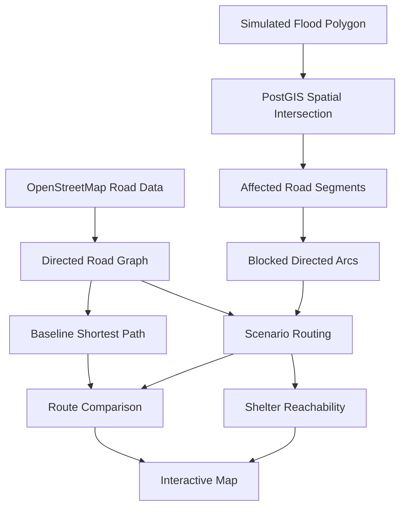
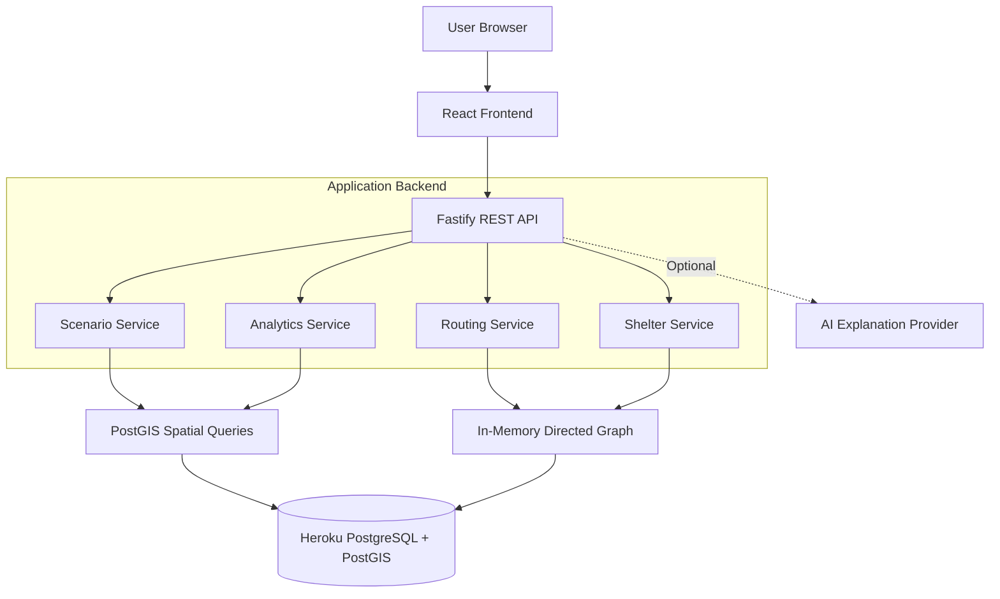
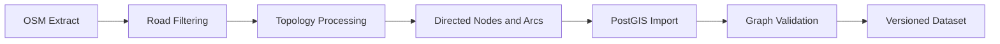
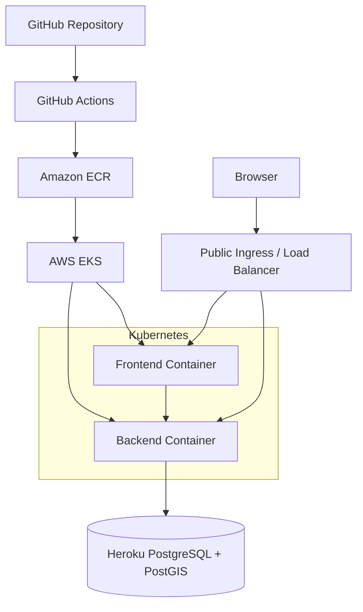

# Flood Digital Twin

### Geospatial Flood Scenario Analysis & Road Network Resilience

**CL-01 — Flood Risk & Evacuation Planner**

An interactive geospatial decision-support prototype that explores how simulated flooding affects road accessibility, shortest paths and shelter reachability.

Built with real OpenStreetMap-derived roads, PostgreSQL/PostGIS, graph algorithms and an interactive map interface.

> **Important:** Flood Digital Twin is a scenario-analysis prototype. Its flood zones are hypothetical. It does not provide real-time flood predictions, official evacuation instructions or verified safe routes.

---

## Project Status

**Current status:** Foundation implemented (SET-01–SET-08); verification evidence is maintained in `.ai/HANDOFF.md`. Geographic analysis and deployment remain pending.

The architecture and implementation specifications are prepared. Features, deployment and test results must be verified against the actual repository before being marked complete.

| Component | Planned technology | Verification |
|---|---|---|
| Interactive map | React + MapLibre | Pending |
| Road network | OpenStreetMap | Pending |
| Spatial analysis | PostgreSQL + PostGIS | Pending |
| Routing engine | TypeScript Dijkstra | Pending |
| Flood scenarios | Simulated polygons | Pending |
| Shelter reachability | Directed graph analysis | Pending |
| Backend API | Fastify + TypeScript | Pending |
| Infrastructure | AWS EKS + Terraform | Pending |
| CI/CD | GitHub Actions | Pending |

---

## 1. The Problem

During flooding, a road network can become fragmented.

A road that is normally available may become impassable, potentially disconnecting neighborhoods from important destinations.

Traditional shortest-path routing does not automatically account for hypothetical flood-related road closures.

This creates several planning questions:

- Which roads would be affected by a given flood scenario?
- How would a shortest route change?
- Would an alternative connected route still exist?
- Which shelter candidates would remain reachable?
- How does network accessibility change across scenarios?

Flood Digital Twin provides an interactive environment for exploring these questions using deterministic geospatial and graph analysis.

---

## 2. Our Solution

Flood Digital Twin combines five core capabilities:

**Real road network:** Imports actual OSM-derived roads and constructs a directed graph.

**Simulated flood scenarios:** Displays predefined hypothetical flood polygons over a selected study area.

**Spatial road-impact detection:** Uses PostGIS to identify physical road segments intersecting simulated flood zones.

**Scenario-aware routing:** Excludes affected graph arcs and recalculates shortest paths.

**Shelter accessibility:** Evaluates which shelter candidates remain connected through the road network.

The results are visualized in a map-first interface designed for scenario exploration.

---

## 3. Core Workflow



### Example scenario

A user selects an origin and destination.

The application first calculates a baseline route using the road graph.

The user then activates a hypothetical flood scenario.

PostGIS identifies intersecting road segments. The routing engine excludes their directed arcs and recalculates the path.

The interface compares the results.

If no valid graph path exists, the application reports the destination as unreachable rather than inventing a route.

---

## 4. Key Features

### Interactive Geospatial Workspace

- MapLibre-based map.
- Road network visualization.
- Flood polygon overlays.
- Baseline and scenario route layers.
- Scenario selection controls.
- Road-impact inspector.

### Flood Scenario Analysis

- Three predefined simulated scenarios.
- Deterministic road intersection calculations.
- Affected physical road segment counts.
- Scenario-specific road closures.
- Reproducible results.

### Graph-Based Routing

- Directed road graph.
- One-way road support.
- Dijkstra shortest-path algorithm.
- Binary min-heap priority queue.
- Scenario-specific blocked arcs.
- Explicit unreachable states.

### Shelter Reachability

- Shelter candidate visualization.
- Road-network accessibility checks.
- Reachable, unreachable and unknown statuses.
- Scenario-dependent connectivity.

### Impact Analytics

- Affected road counts.
- Baseline versus scenario route distances.
- Route-distance changes.
- Reachability summaries.
- Dataset provenance.

### Optional AI Explanation

An optional AI component may explain verified analytical results in natural language.

AI is not responsible for calculating flood intersections, graph routes or shelter reachability.

The system must remain functional without AI.

---

## 5. What Makes It Different?

### 1. Network-aware analysis

The project goes beyond drawing flood polygons on a map.

It connects spatial road impacts to graph-based accessibility analysis.

### 2. Deterministic routing

Routes are computed using a reproducible algorithm, not generated by an LLM.

### 3. Scenario comparison

Users can compare the original road network against a simulated disrupted network.

### 4. Explicit uncertainty

The application distinguishes hypothetical flood scenarios, graph connectivity and real-world safety.

### 5. Cloud-native delivery

The intended deployment uses a containerized application with existing Terraform and Kubernetes infrastructure adapted for AWS.

Deployment details will be updated after verification.

---

## 6. Technology Stack

| Layer | Technology |
|---|---|
| Frontend | React, Vite, TypeScript |
| Styling | Tailwind CSS, shadcn/ui |
| Maps | MapLibre GL JS |
| State | Zustand, TanStack Query |
| Charts | Recharts |
| Icons | Lucide React |
| Backend | Node.js, Fastify, TypeScript |
| Validation | Zod |
| ORM | Drizzle |
| Database | PostgreSQL |
| Geospatial | PostGIS |
| Road data | OpenStreetMap |
| Routing | TypeScript Dijkstra |
| Unit testing | Vitest |
| E2E testing | Cypress |
| Containers | Docker |
| Infrastructure | Terraform, Kubernetes |
| Cloud | AWS EKS, Amazon ECR |
| CI/CD | GitHub Actions |
| Optional AI | DigitalOcean hosted inference |

Technology availability and final deployment details must be verified during implementation.

---

## 7. System Architecture



### Architecture principles

- Modular monolith backend.
- Shared API contracts.
- Deterministic analysis.
- Spatial queries in PostGIS.
- Graph routing in TypeScript.
- External managed PostgreSQL.
- Independent frontend and backend containers.

---

## 8. Geospatial Data Pipeline

The road network is constructed from a bounded OpenStreetMap extract.



### Road representation

A road network consists of:

**Nodes:** Graph intersections or endpoints.

**Directed arcs:** Traversable connections between nodes.

**Physical segments:** Road geometry that may correspond to one or more directed arcs.

For a bidirectional physical segment, two directed arcs can represent opposite travel directions.

For a one-way segment, only the permitted direction is represented.

### Data quality

The importer must account for:

- Road connectivity.
- One-way restrictions.
- Road intersections.
- Bridges and tunnels.
- Duplicate segments.
- Invalid geometry.
- Dataset versioning.

---

## 9. Flood Simulation Methodology

Flood scenarios are represented as valid geospatial polygons.

A physical road segment is considered affected when it intersects a scenario polygon.

The primary spatial operation is:

```sql
SELECT DISTINCT
    physical_segment_id
FROM road_edges
WHERE ST_Intersects(
    road_edges.geom,
    :flood_polygon
);
```

The SQL above illustrates the spatial operation; actual queries must use the implemented schema and parameterized values.

### Closure rule

When a physical segment is affected:

1. Identify its physical segment ID.
2. Find all associated directed arcs.
3. Add those arcs to the scenario's blocked set.
4. Exclude those arcs from routing.
5. Preserve the original base graph.

This rule is a modeling assumption for hypothetical scenarios, not a validated real-world passability assessment.

---

## 10. Shortest-Path Algorithm

The routing engine uses Dijkstra's algorithm with nonnegative road-length weights.

### Baseline route

Calculate the shortest path through the complete permitted road graph.

### Scenario route

Calculate the shortest path after excluding arcs affected by the selected simulated flood polygon.

### Algorithm outline

```text id="5e6yxe"
function shortestPath(graph, start, destination, blockedArcs):

    initialize distances to infinity
    distance[start] = 0

    create min-priority queue
    insert start

    while queue is not empty:

        current = extract minimum

        if current is destination:
            reconstruct path

        for each outgoing arc:

            if arc is blocked:
                continue

            candidate = distance[current] + arc.length

            if candidate improves distance:
                update distance
                remember predecessor
                push updated candidate

    return unreachable
```

### Complexity

With an adjacency list and binary heap, the standard complexity is:

\[
O((V+E)\log V)
\]

Where:

- \(V\) = graph vertices.
- \(E\) = directed graph arcs.

### Important invariant

Removing road arcs cannot produce a shorter optimal route between the same graph nodes when weights are unchanged and nonnegative.

This property is included in the routing verification strategy.

---

## 11. Database Design

The planned core entities include:

| Entity | Responsibility |
|---|---|
| `dataset_versions` | Imported dataset metadata |
| `study_areas` | Geographic study regions |
| `road_nodes` | Graph vertices |
| `road_edges` | Directed road arcs |
| `flood_scenarios` | Scenario metadata |
| `flood_zones` | Simulated polygon geometries |
| `shelters` | Shelter candidates and attributes |
| `analysis_runs` | Optional analysis history |

### Spatial considerations

- EPSG:4326 geometry storage.
- GiST spatial indexes.
- Meter-based routing weights.
- Dataset-version consistency.
- Parameterized queries.
- Directed-graph integrity.

Detailed schema: `docs/06-DATABASE-SCHEMA.md`.

---

## 12. API Overview

All application endpoints use the `/api/v1` prefix.

| Method | Endpoint | Purpose |
|---|---|---|
| GET | `/api/v1/study-areas` | Available study areas |
| GET | `/api/v1/study-areas/:id/roads` | Road network GeoJSON |
| GET | `/api/v1/study-areas/:id/scenarios` | Available scenarios |
| GET | `/api/v1/scenarios/:id/zones` | Scenario flood polygons |
| GET | `/api/v1/scenarios/:id/impact` | Affected road metrics |
| POST | `/api/v1/routing/snap` | Snap point to graph |
| POST | `/api/v1/routing/route` | Calculate route |
| POST | `/api/v1/routing/compare` | Compare baseline and scenario |
| GET | `/api/v1/study-areas/:id/shelters` | Shelter candidates |
| POST | `/api/v1/shelters/reachability` | Shelter connectivity |
| GET | `/api/v1/study-areas/:id/summary` | Study-area metrics |
| GET | `/api/v1/data/provenance` | Dataset attribution |

Health endpoints:

- `GET /health`
- `GET /ready`

The complete contract is defined in `docs/10-API-CONTRACT.md`.

---

## 13. User Interface

The application follows the **ATLAS — Geospatial Operations Console** design system.

### Desktop workspace

```text id="5u4v73"
┌──────────────────────────────────────────────────────────────┐
│ Flood Digital Twin                            Status / Info  │
├──────────────┬───────────────────────────┬───────────────────┤
│              │                           │                   │
│ SCENARIO LAB │                           │ IMPACT INSPECTOR  │
│              │                           │                   │
│ Study Area   │                           │ Road Impact       │
│ Scenario     │       INTERACTIVE         │ Route Comparison  │
│ Route Inputs │          MAP              │ Shelter Access    │
│ Controls     │                           │ Metrics           │
│              │                           │                   │
├──────────────┴───────────────────────────┴───────────────────┤
│ Dataset Version  |  Simulated Scenario  |  Data Attribution │
└──────────────────────────────────────────────────────────────┘
```

### Design principles

- Map-first layout.
- Clear visual hierarchy.
- Professional geographic interface.
- Consistent Lucide icons.
- No emojis in application UI.
- Accessible controls.
- Responsive layouts.
- Real metrics only.
- Visible simulated-data disclaimer.

Detailed design specification: `docs/05-UI-UX-DESIGN.md`.

---

## 14. Repository Structure

The intended monorepo structure is:

```text id="cm2vpx"
flood-digital-twin/
├── app/
│   ├── frontend/
│   │   └── ...
│   └── backend/
│       └── ...
│
├── packages/
│   └── shared/
│       └── ...
│
├── terraform/
├── k8s/
│
├── .github/
│   └── workflows/
│
├── docs/
│   ├── 01-PROBLEM-ANALYSIS.md
│   ├── 02-PRD.md
│   ├── 03-TRD.md
│   ├── 04-SYSTEM-ARCHITECTURE.md
│   ├── 05-UI-UX-DESIGN.md
│   ├── 06-DATABASE-SCHEMA.md
│   ├── 07-GEOSPATIAL-DATA-PLAN.md
│   ├── 08-FLOOD-SIMULATION-ENGINE.md
│   ├── 09-ROUTING-ALGORITHMS.md
│   ├── 10-API-CONTRACT.md
│   ├── 11-AI-INTEGRATION.md
│   ├── 12-IMPLEMENTATION-PLAN.md
│   ├── 13-TESTING-PLAN.md
│   ├── 14-DEVOPS-DEPLOYMENT.md
│   ├── 15-DEMO-PRESENTATION.md
│   └── 16-TASK-TRACKER.md
│
├── .ai/
│   ├── CURRENT-STATE.md
│   ├── HANDOFF.md
│   ├── DECISIONS.md
│   └── KNOWN-ISSUES.md
│
├── AGENTS.md
├── README.md
├── package.json
└── pnpm-workspace.yaml
```

Actual infrastructure paths may differ depending on the existing configuration being reused.

---

## 15. Local Development

### Prerequisites

- Node.js 22 LTS (22.12 or newer within major 22).
- pnpm 10.30.1 (pinned in `package.json`).
- PostgreSQL with PostGIS is needed for subsequent database tasks, not foundation startup.
- Git.
- Required environment variables.

### Installation

From the repository root:

```bash
pnpm install
```

### Environment setup

Defaults start the foundation without environment files or credentials. To customize,
copy `app/backend/.env.example` to `app/backend/.env` and
`app/frontend/.env.example` to `app/frontend/.env`.
Backend variables:

```dotenv
DATABASE_URL=
NODE_ENV=development
HOST=0.0.0.0
PORT=3001
CORS_ORIGIN=http://localhost:5173
LOG_LEVEL=info
```

Never commit real credentials.

Frontend configuration is public: `VITE_API_BASE_URL=/api/v1` uses Vite's local
proxy to `http://127.0.0.1:3001`. An absolute HTTP(S) URL ending in `/api/v1`
is also supported. If changing the backend port, update the local proxy target in
`app/frontend/vite.config.ts`. Environment files load from each package directory.

### Development

Run both applications and the shared-schema watcher:

```bash
pnpm dev
```

Open `http://localhost:5173`. The **Service connection** panel fetches
`/api/v1/status` through the proxy and has a retry action. No map or analytical
results are implemented yet.

Backend probes: `http://localhost:3001/health` returns 200 without credentials;
`http://localhost:3001/ready` intentionally returns 503 while PostgreSQL,
dataset and graph initialization remain unimplemented. DATABASE_URL is validated
but no connection is opened. Database credentials alone do not imply readiness.

### Build

```bash
pnpm build
```

### Tests

```bash
pnpm test
```

Run `pnpm typecheck` for all packages. Builds run in dependency order and output
to `packages/shared/dist`, `app/backend/dist`, and `app/frontend/dist`.
Start the compiled backend with `pnpm --filter @flood/backend start`.
`pnpm --filter @flood/frontend preview` previews the static build; it is not a
production web server. Production hosting must route `/api/v1`, `/health`, and
`/ready` to the backend or provide a build-time public API URL.

If the system pnpm launcher cannot switch to the pinned version, use
`npm exec --yes --package=pnpm@10.30.1 -- pnpm install` and the same prefix for
workspace commands. This uses the official npm package without changing the global installation.

### Geospatial dataset

Database migrations and OSM import are separate setup steps.

Use the verified migration and import commands documented after those scripts are implemented.

Do not run destructive database operations against the hosted database.

---

## 16. AWS Deployment

The preferred deployment architecture is:



### Infrastructure strategy

The team already has Terraform and Kubernetes configuration tested on another project.

Rather than rebuilding everything, the infrastructure workstream will:

1. Audit the existing configuration.
2. Identify reusable resources.
3. Update application-specific values.
4. Validate Terraform.
5. Review the Terraform plan.
6. Adapt Docker and Kubernetes manifests.
7. Configure CI/CD.
8. Deploy the application.
9. Run public smoke tests.

### Security

- Secrets injected at runtime.
- No credentials in Git.
- Parameterized SQL.
- Validated environment configuration.
- Restricted AWS permissions.
- Secure database connectivity.

### Deployment status

**Public URL:** `[ADD VERIFIED DEMO URL]`

**AWS region:** `[ADD ACTUAL REGION]`

**EKS cluster:** `[ADD ACTUAL CLUSTER]`

**Deployment verification:** Pending.

Do not replace these placeholders until deployment is working.

---

## 17. Testing Strategy

The project uses a layered verification approach.

### Unit tests

- Dijkstra correctness.
- Binary heap.
- Directed graph behavior.
- One-way restrictions.
- Unreachable routes.
- Route reconstruction.

### Integration tests

- PostGIS intersections.
- Affected physical segment deduplication.
- Blocked arc generation.
- Dataset-version consistency.
- Shelter reachability.
- API validation.

### End-to-end tests

- Load study area.
- Select route endpoints.
- Display baseline route.
- Activate simulated scenario.
- Display affected roads.
- Compare scenario route.
- Inspect shelter reachability.

### Deployment tests

- Frontend accessibility.
- Backend health.
- Database connectivity.
- API responses.
- Core demo workflow.

### Test status

| Test suite | Result |
|---|---|
| Unit tests | Not yet verified |
| Spatial integration tests | Not yet verified |
| API tests | Not yet verified |
| Cypress E2E | Not yet verified |
| Deployment smoke tests | Not yet verified |

Update this table only with actual test results.

---

## 18. Demo Walkthrough

The intended live demonstration follows this sequence.

### Step 1 — Explore the map

Display the real road network in the selected study area.

### Step 2 — Calculate a baseline route

Choose an origin and destination and calculate the shortest graph path.

### Step 3 — Activate a flood scenario

Display a hypothetical flood polygon over the map.

### Step 4 — Inspect affected roads

Highlight physical road segments intersecting the polygon.

### Step 5 — Compare routes

Show the scenario-aware shortest path after affected arcs are removed.

### Step 6 — Analyze shelters

Display shelter candidates and their scenario-dependent reachability.

### Step 7 — Compare scenarios

Switch between predefined simulations and observe changes.

The final origin, destination and scenarios must be pre-verified so the demo is reproducible.

---

## 19. Screenshots

Screenshots will be added after the interface has been implemented and visually verified.

### Main Workspace

`[ADD ACTUAL WORKSPACE SCREENSHOT]`

### Flood Scenario Analysis

`[ADD ACTUAL SCENARIO SCREENSHOT]`

### Route Comparison

`[ADD ACTUAL ROUTING SCREENSHOT]`

Do not use AI-generated UI mockups as evidence of a working application.

---

## 20. Data Sources & Attribution

### OpenStreetMap

Road network data is derived from OpenStreetMap contributors.

**Attribution:** © OpenStreetMap contributors.

OpenStreetMap data is available under the Open Database License (ODbL).

Source: https://www.openstreetmap.org/copyright

### Map tiles

The map tile provider and required attribution must be verified during implementation.

### Flood polygons

The flood scenarios are hypothetical and created for demonstration and analytical testing.

They are not validated flood forecasts.

### Shelter data

Shelter records must carry appropriate provenance and verification status.

A candidate's graph reachability does not establish that it is operational or safe.

---

## 21. Limitations

The initial prototype has several intentional limitations:

- It covers a bounded study area.
- Flood polygons are hypothetical.
- Road closures follow a simplified spatial-intersection rule.
- No real-time flood sensor integration is assumed.
- No hydrological forecasting model is included.
- Road-network completeness depends on source data quality.
- Shelter availability and safety are not guaranteed.
- Travel-time modeling may be less reliable than distance-based routing.
- Public deployment depends on verified cloud infrastructure.

These limitations are part of responsible scenario modeling.

---

## 22. Future Improvements

Potential future extensions include:

- Integration with authoritative flood forecasts.
- Time-dependent road closures.
- Traffic-aware routing.
- Accessibility-sensitive route analysis.
- Population exposure analysis.
- Multi-region datasets.
- Historical scenario comparison.
- Verified emergency facility datasets.
- Improved network resilience metrics.
- Collaborative scenario planning.

These are future directions, not current feature claims.

---

## 23. Team & Responsibilities

### Developer A — Application Engineering

Responsible for:

- Frontend.
- Backend.
- PostGIS schema.
- Geospatial data import.
- Flood simulation.
- Routing algorithms.
- Shelter analysis.
- UI integration.

### Developer B — Cloud & Infrastructure

Responsible for:

- Terraform adaptation.
- Kubernetes adaptation.
- Docker.
- AWS EKS/ECR.
- GitHub Actions.
- Public deployment.
- Infrastructure validation.

Both developers contribute to testing, documentation and presentation.

**Team member names:** `[ADD FINAL TEAM DETAILS]`

---

## 24. Project Documentation

The repository includes detailed engineering documentation.

| Document | Purpose |
|---|---|
| `01-PROBLEM-ANALYSIS.md` | Problem and impact |
| `02-PRD.md` | Product requirements |
| `03-TRD.md` | Technical requirements |
| `04-SYSTEM-ARCHITECTURE.md` | Architecture |
| `05-UI-UX-DESIGN.md` | Design system |
| `06-DATABASE-SCHEMA.md` | Data model |
| `07-GEOSPATIAL-DATA-PLAN.md` | OSM data pipeline |
| `08-FLOOD-SIMULATION-ENGINE.md` | Spatial impact |
| `09-ROUTING-ALGORITHMS.md` | Shortest-path routing |
| `10-API-CONTRACT.md` | REST API specification |
| `11-AI-INTEGRATION.md` | Optional AI |
| `12-IMPLEMENTATION-PLAN.md` | Development roadmap |
| `13-TESTING-PLAN.md` | Quality assurance |
| `14-DEVOPS-DEPLOYMENT.md` | Infrastructure and deployment |
| `15-DEMO-PRESENTATION.md` | Demo preparation |
| `16-TASK-TRACKER.md` | Task management |

Agent workflow files:

- `AGENTS.md`
- `.ai/CURRENT-STATE.md`
- `.ai/HANDOFF.md`
- `.ai/DECISIONS.md`
- `.ai/KNOWN-ISSUES.md`

---

## 25. Hackathon Evaluation Alignment

| Evaluation Area | Project Contribution |
|---|---|
| Technical Implementation — 25% | PostGIS, directed graph, Dijkstra, full-stack integration |
| Problem & Impact — 20% | Road accessibility under hypothetical flood disruptions |
| Innovation — 20% | Spatial-to-network impact analysis and scenario-aware routing |
| Usability & Design — 15% | Interactive map-first ATLAS interface |
| Feasibility — 10% | Bounded study area and deterministic methods |
| Demo & Presentation — 10% | Reproducible baseline-to-scenario walkthrough |

The strongest demonstration is a working, technically correct route comparison using real roads and simulated closures.

---

## 26. Project Links

**GitHub Repository:** `[ADD REPOSITORY URL]`

**Live Application:** `[ADD VERIFIED PUBLIC URL]`

**Demo Video:** `[ADD DEMO VIDEO URL]`

**Presentation:** `[ADD PRESENTATION LINK]`

Only add links that are publicly accessible and verified.

---

## 27. Responsible Use

Flood Digital Twin is intended for educational, research and prototype planning scenarios.

Its outputs should not be used as authoritative instructions for emergency response.

Real-world evacuation decisions require current official information, verified road conditions, validated hazard data and guidance from responsible authorities.

---

## Closing

**Flood Digital Twin connects geospatial flood scenarios with real road-network analysis to make hypothetical accessibility disruptions easier to explore, compare and understand.**

The core idea is simple:

**When a road network changes, the routes and destinations reachable through it can change too.**

---

**Built for CL-01 — Flood Risk & Evacuation Planner.**
