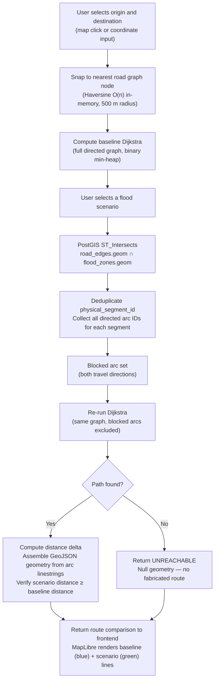
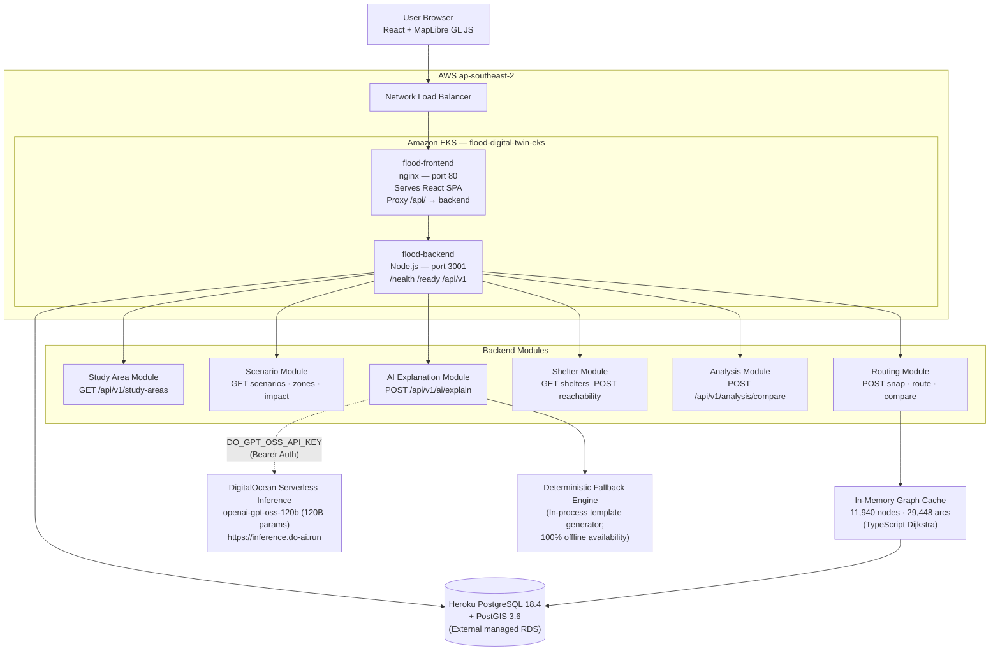
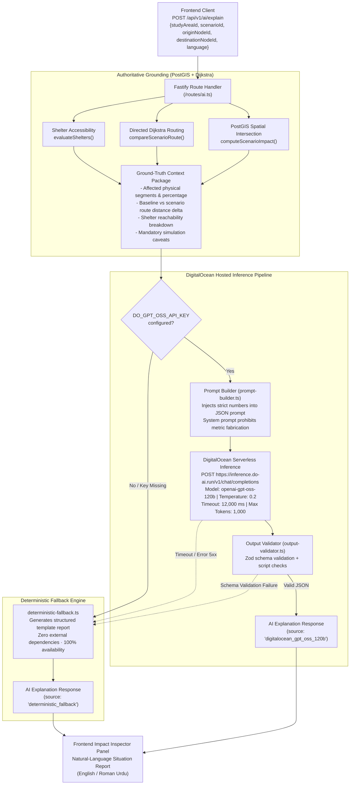
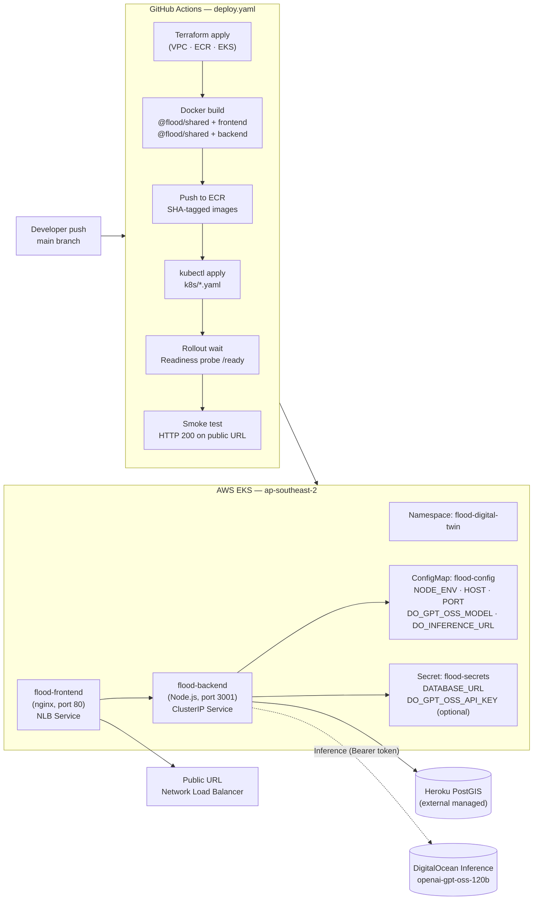
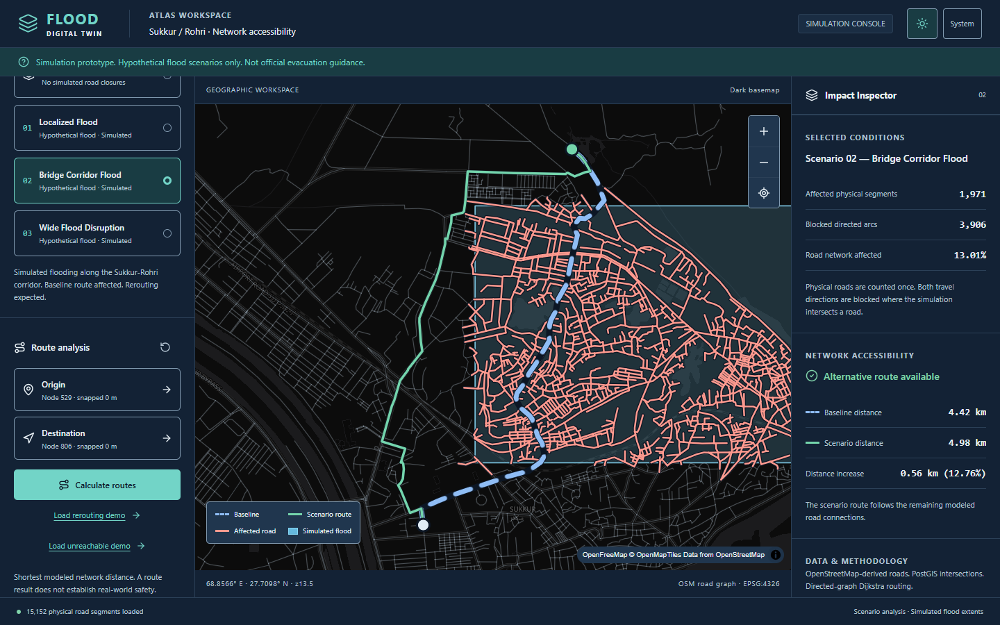
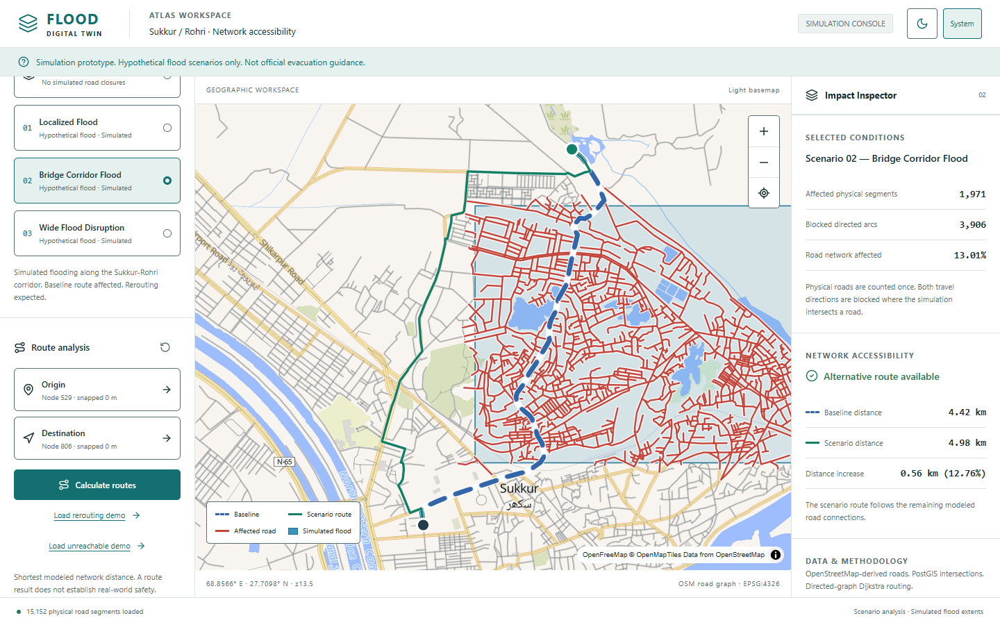
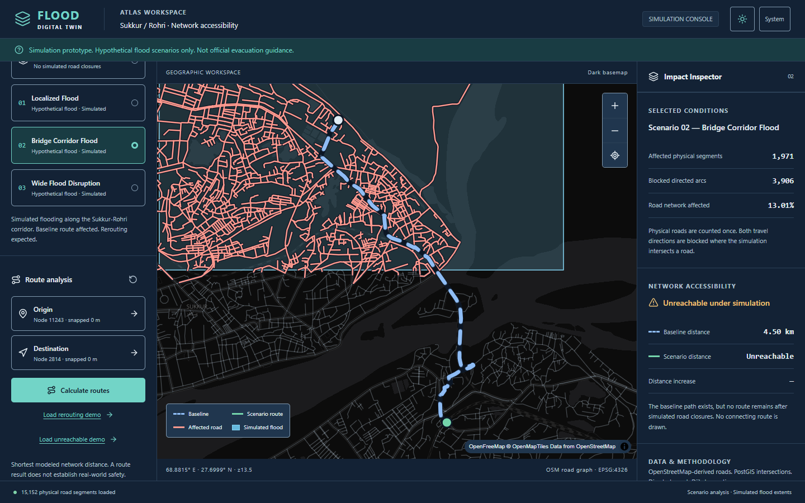
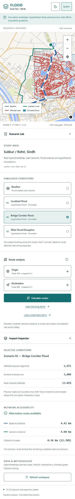
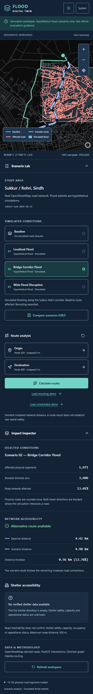

# ATLAS — Flood Digital Twin

**Exploring how hypothetical flood scenarios reshape road-network accessibility and route planning in real urban terrain.**

CL-01 · Climate Resilience & Disaster Management · Hackathon Submission

---

| | |
|---|---|
| **Live Demo** | [http://acc8e62b434c84a26ac87f22b9c0a716-aad1bc7f4f666153.elb.ap-southeast-2.amazonaws.com/](http://acc8e62b434c84a26ac87f22b9c0a716-aad1bc7f4f666153.elb.ap-southeast-2.amazonaws.com/) |
| **Pilot Area** | Sukkur / Rohri, Sindh, Pakistan |
| **Road Data** | OpenStreetMap · ODbL · © OpenStreetMap contributors |
| **Deployment** | AWS EKS · ap-southeast-2 · Kubernetes + GitHub Actions |
| **Simulation** | Hypothetical flood scenarios only — not a real-time flood forecast |

---

[](https://www.typescriptlang.org/)
[](https://nodejs.org/)
[](https://react.dev/)
[](https://maplibre.org/)
[](https://postgis.net/)
[](https://fastify.dev/)
[](https://aws.amazon.com/eks/)
[](https://www.terraform.io/)
[](https://www.digitalocean.com/)

---

## Contents

- [Repository Structure](#repository-structure)
- [The Problem](#the-problem)
- [Our Solution](#our-solution)
- [Live Demo](#live-demo)
- [Engineering Results](#engineering-results)
- [Core Features](#core-features)
- [How Flood-Aware Routing Works](#how-flood-aware-routing-works)
- [System Architecture](#system-architecture)
  - [AI Explanation Architecture & DigitalOcean Inference Pipeline](#ai-explanation-architecture--digitalocean-inference-pipeline)
- [Data & Methodology](#data--methodology)
- [Tech Stack](#tech-stack)
- [Cloud Deployment & CI/CD](#cloud-deployment--cicd)
- [Application Screenshots](#application-screenshots)
- [Local Development](#local-development)
- [Testing](#testing)
- [Limitations & Responsible Use](#limitations--responsible-use)
- [Future Roadmap](#future-roadmap)
- [Team & Acknowledgments](#team--acknowledgments)

---

## Repository Structure

```text
Predators/
├── app/
│   ├── frontend/            # React 19 + Vite + MapLibre GL workspace (ATLAS)
│   │   ├── src/             # screens, map layers, API client, theme, stores
│   │   ├── scripts/         # Playwright browser verification + screenshots
│   │   └── dist/            # production bundle (nginx-served in EKS)
│   └── backend/             # Fastify 5 modular monolith
│       ├── src/
│       │   ├── modules/     # study areas, scenarios, spatial analysis, routing, shelters, AI
│       │   ├── routes/      # /api/v1 route handlers (Zod-validated envelopes)
│       │   ├── routing/     # TypeScript Dijkstra + binary min-heap + graph cache
│       │   ├── db/          # pg pool (TLS), Drizzle schema, spatial queries
│       │   └── services/    # AI provider adapter, deterministic fallback
│       ├── migrations/      # 001_initial_schema.sql (PostGIS schema)
│       ├── scripts/         # import, validate, seed, inspect, verify-demo
│       └── tests/           # 169 vitest tests (live PostGIS integration)
├── packages/
│   └── shared/              # @flood/shared — Zod schemas + types shared across the API boundary
├── dataset/                 # processed road graph + flood seed + OSM extract (untracked large files)
├── docs/                    # 16 project documents (problem → deployment → task tracker)
├── terraform/               # IaC — VPC, ECR, EKS modules (state in S3)
├── k8s/                     # namespace, deployments, services, HPA, PDB, configmap, secrets
├── .github/workflows/       # deploy.yaml (TF → build → ECR → kubectl → smoke test)
└── .ai/                     # agent state: current state, handoff, decisions, known issues
```

---

## The Problem

Sukkur and Rohri sit on opposite banks of the Indus River in Sindh, Pakistan — a region historically exposed to seasonal flooding. When roads flood, a network that appears intact on a static map can silently fragment. A bridge becomes impassable. A ring road disappears. Communities that were minutes apart become hours — or unreachable.

Static mapping tools cannot answer the critical planning questions:

- **Which specific roads** would be cut by a given flood extent?
- **Does an alternative route still exist**, or is the destination now unreachable?
- **How much longer** is the detour when it does exist?
- **Which shelter candidates** remain reachable through the surviving road network?
- **How do the answers change** across flood extents of different sizes and locations?

Answering these questions rigorously requires connecting spatial intersection analysis with graph-based routing — not just displaying polygons on a tile layer.

---

## Our Solution

ATLAS (flood digital twin) provides an interactive workspace that takes a real road network, applies hypothetical flood extents, and computes deterministic route and accessibility outcomes using the actual road graph.

The full data and computation pipeline:

```
Real OpenStreetMap Roads (Sukkur/Rohri, Sindh)
        ↓
PostgreSQL/PostGIS — Directed Road Graph
        ↓
Baseline Dijkstra Shortest Path
        ↓
Select Hypothetical Flood Scenario
        ↓
PostGIS ST_Intersects — Affected Physical Road Segments
        ↓
Identify All Associated Directed Arcs (both travel directions)
        ↓
Re-run Dijkstra Excluding Blocked Arcs
        ↓
Compute Route Delta / Detect Unreachable
        ↓
Evaluate Shelter Candidate Reachability
        ↓
MapLibre GL Interactive Map — Scenario Comparison
```

Every road closure, route distance and reachability result is a deterministic output of actual graph analysis against real imported data. No routes are generated by AI or approximated with straight-line distance.

---

## Live Demo

**[Open ATLAS Live Demo →](http://acc8e62b434c84a26ac87f22b9c0a716-aad1bc7f4f666153.elb.ap-southeast-2.amazonaws.com/)**

> **Note:** The public URL uses HTTP (not HTTPS). The demo is deployed on AWS EKS via a Network Load Balancer in `ap-southeast-2`. It is a prototype for scenario analysis and demonstration, not a production emergency service.

### Reproducing the demo workflow

1. **Open the app** — the Sukkur/Rohri road network loads automatically.
2. **Click "Load rerouting demo"** — this snaps two real coordinates to the nearest graph nodes (node 529 → 806) and selects the Bridge Corridor Flood scenario.
3. **Click "Calculate routes"** — the baseline route (4.42 km) and scenario route (4.98 km) appear as separate lines on the map.
4. **Inspect the Impact Inspector** — see 1,971 affected physical segments, 3,906 blocked directed arcs, and the +563.9 m / +12.76% route increase.
5. **Click "Load unreachable demo"** — switch the origin and destination (node 11243 → 2814) to see a case where the baseline route exists but the scenario closes the only connecting path.
6. **Click "Compare scenarios A/B/C"** — open the comparison panel to see closure counts, route deltas and reachability across all three scenarios simultaneously.
7. **Toggle Light/Dark theme** — the map overlay layers, flood polygons and route lines are preserved across theme changes.

---

## Engineering Results

The following values are outputs of deterministic computation against the actual imported dataset. They are simulation results for hypothetical flood scenarios and do not represent real observed flood conditions.

### Road Network

| Metric | Value |
|---|---|
| Road graph nodes | **11,940** |
| Directed road arcs | **29,448** |
| Physical road segments | **15,152** |
| Largest connected component | **11,883 nodes (99.5%)** |
| Isolated nodes | 0 |
| Study area | Sukkur / Rohri, Sindh |
| Dataset | `sukkur-osm-2026-10-v1` |
| OSM data license | ODbL — © OpenStreetMap contributors |

### Scenario Impact Comparison

Computed for demonstration node pair: **origin node 529 → destination node 806**

| Scenario | Physical Closures | Blocked Directed Arcs | Route Distance | Change vs Baseline |
|---|---:|---:|---:|---:|
| **Baseline** | 0 | 0 | **4,417.8 m** | — |
| **A — Localized Flood** | 549 | 1,082 | **4,853.0 m** | +435.2 m / **+9.85%** |
| **B — Bridge Corridor Flood** | 1,971 | 3,906 | **4,981.7 m** | +563.9 m / **+12.76%** |
| **C — Wide Flood Disruption** | 1,682 | 3,283 | **Unreachable** | — |

> Scenario C closes the only connected path between these nodes. The application reports UNREACHABLE rather than returning a fabricated route.

### Scenario Overlap Analysis

| Compared scenarios | Shared physical closures |
|---|---|
| A ∩ B | 10 segments |
| A ∩ C | 0 segments |
| B ∩ C | 16 segments |
| Union A ∪ B ∪ C | 4,176 unique segments |
| Shared by all three | 0 segments |

### Test Coverage (verified)

| Suite | Tests |
|---|---|
| Backend (graph, routing, flood, DB, accessibility, AI, API protection, summaries) | **169 / 169** |
| Frontend (API, map layers, accessibility, theme, AI brief, data provenance) | **67 / 67** |
| Browser E2E (Playwright, desktop + mobile, Light/Dark) | Passed |
| TypeScript typecheck (all packages) | Passed |
| Production build (frontend + backend) | Passed |
| End-to-end demo verifier (real graph, reroute + unreachable fixtures) | Passed |

---

## Core Features

### Interactive Geospatial Workspace

A map-first interface built on MapLibre GL JS with the OpenFreeMap vector tile service. The map renders the full road network, flood zone polygons, affected road highlights, and route lines simultaneously. Layers are reinstated correctly after theme switches between Light and Dark styles.

### Real Road Network (OpenStreetMap)

11,940 nodes and 29,448 directed arcs imported from a bounded OSM extract of Sukkur/Rohri. One-way road restrictions are respected. Physical segments with bidirectional travel generate two directed arcs; one-way segments generate one. The topology was independently validated with 18 checks before being accepted.

### Flood Zone Intersection (PostGIS)

Hypothetical flood polygons stored in PostGIS. When a scenario is selected, `ST_Intersects` identifies every physical road segment that touches the flood polygon (boundary contact included). Both forward and reverse arcs for each affected segment are added to the blocked set.

### Directed-Graph Dijkstra Routing

A TypeScript Dijkstra implementation using a binary min-heap priority queue. The algorithm operates on an adjacency list built from the PostGIS road graph. Blocked arc sets are passed at query time — the base graph is never mutated. Route geometry is assembled from the real imported arc geometries.

### Scenario-Aware Route Comparison

Every route request returns both a baseline result (full graph) and a scenario result (graph minus blocked arcs). The outcome is one of: `found`, `rerouted`, `unchanged`, `unreachable`, or `baseline_unreachable`. A key safety invariant is enforced: the scenario route distance cannot be shorter than the baseline distance when only arcs have been removed.

### Unreachable Route Detection

When no graph path exists under the active scenario, the API returns an explicit `unreachable` status with a null geometry. The map shows no scenario route line. The Impact Inspector reports the state clearly. No fallback straight-line route is generated.

### Scenario Comparison (A/B/C)

A dedicated comparison panel accepts up to three scenarios simultaneously. It returns baseline and scenario routes for each, physical segment overlap sets, blocked arc counts, reachability for shelter candidates, and distance deltas. Physical closure sets are deduplicated and the pairwise intersections are computed.

### Shelter Network Reachability

The shelter accessibility subsystem snaps candidate locations to the nearest road graph node within 500 m. A single-source Dijkstra from the chosen origin computes reachability for all candidates simultaneously under both baseline and scenario conditions. Each candidate receives a status of `reachable`, `unreachable` or `unknown` with an explicit reason. The live database has zero verified shelter records; the UI shows an honest empty state. A separate hypothetical demonstration mode (not active in production) uses in-memory fixture destinations for development testing.

PostGIS independently checks whether each candidate location falls within a simulated flood polygon. This flood flag is displayed separately and does not override network reachability.

### Data Provenance (About Data)

The About Data screen (`GET /api/v1/data/provenance` + `GET /study-areas/:id/summary`) presents the dataset's full provenance chain — source (OpenStreetMap extract, Sukkur/Rohri bounds), dataset version (`sukkur-osm-2026-10-v1`), license (ODbL), import date, and live table-level statistics (nodes, arcs, physical segments, scenarios) — together with the study-area summary counts. Every value is read from the live database; nothing is hardcoded in the UI.

### AI Scenario Explanation (implemented, optional)

A `POST /api/v1/ai/explain` endpoint generates natural-language situational summaries of verified deterministic results using a DigitalOcean-hosted inference endpoint:

- **Inference Provider:** DigitalOcean Gradient / Serverless Inference (`https://inference.do-ai.run/v1/chat/completions`).
- **Hosted Model:** `openai-gpt-oss-120b` (120-billion parameter open-weights model).
- **Strict Grounding:** The prompt builder embeds authoritative metrics directly from PostGIS (`computeScenarioImpact`), Dijkstra (`compareScenarioRoute`), and the shelter engine (`evaluateShelters`). The AI model is strictly prohibited from estimating distances, guessing closure counts, or inventing routes.
- **Output Validation:** All model outputs pass through a Zod schema validator (`output-validator.ts`) that enforces structured JSON (`summary`, `observations`, `confidence`, `limitations`), verifies script integrity (English / Roman Urdu), and guarantees simulation caveats are preserved.
- **Deterministic Fallback:** If `DO_GPT_OSS_API_KEY` is omitted, the inference endpoint times out (12 s), or the upstream returns malformed JSON, the backend automatically serves an instant deterministic fallback explanation (`deterministic-fallback.ts`) without disrupting the application or frontend UI.
- **AI Decision Brief (Reports):** the frontend `AiBrief` panel exposes this endpoint behind a single explicit "Generate explanation" action (no automatic paid calls, no retries on failure). The response source — DigitalOcean inference or deterministic fallback — is labelled transparently in the panel.

### Light / Dark Theme

A dual theme system built on CSS custom properties under an ATLAS design token set. The currently selected theme (Light, Dark, or System) is persisted in `localStorage` and applied before the first render to prevent flash. Theme toggles on the topbar update both the document root and the MapLibre style URL.

### Responsive Design

The three-column workspace (Scenario Lab · Map · Impact Inspector) collapses to a single-column stacked layout on mobile. Tested at 1440×900, 1280×800 and 390×844 viewports in both themes using Playwright.

---

## How Flood-Aware Routing Works



### Why directed arcs matter

A bidirectional road has **two** directed arcs — one in each travel direction. A one-way road has **one**. When a physical segment is flooded, both arcs for that segment are blocked. This correctly prevents the algorithm from using the flooded road in either direction, while preserving one-way restrictions on adjacent unaffected roads.

### The baseline invariant

When arcs are only removed (never added), the shortest path through the surviving graph cannot be shorter than the shortest path through the full graph. This invariant is enforced in the `compareRoutes` function — if violated, an error is thrown before the result is returned.

### Distance vs straight-line

All distances are **network distances** measured along the actual road graph using Haversine arc lengths stored in the database. No Euclidean or straight-line approximations are used anywhere in the routing pipeline.

---

## System Architecture



### Key architectural decisions

| Decision | Rationale |
|---|---|
| Modular monolith backend | Simpler ops; no inter-service network overhead for the routing–flood integration |
| In-memory graph cache | Dijkstra requires random adjacency access; loading from DB per request would be prohibitively slow |
| PostGIS for intersection | The spatial index on `road_edges.geom` and `flood_zones.geom` makes ST_Intersects efficient even for 29 K arcs |
| nginx as API proxy | Single public port; no Ingress controller required with the NLB approach |
| External Heroku DB | Heroku-managed PostgreSQL + PostGIS avoids running a stateful set inside EKS |
| DigitalOcean Hosted Inference | Offloads 120B open-weights model inference to managed cloud GPU endpoints; keeps Node.js backend lightweight |
| Dedicated self-hosted PostgreSQL | PostGIS + full schema ownership on a dedicated Heroku RDS instance — no external database service coupling in the application code |
| Deterministic fallback guard | Decouples application uptime from LLM availability; routing & analysis work 100% offline or without API keys |

### AI Explanation Architecture & DigitalOcean Inference Pipeline

The AI explanation subsystem provides natural-language situational awareness based strictly on deterministic geospatial findings. It operates as an asynchronous explanation layer completely decoupled from core pathfinding.



#### Grounding & Hallucination Prevention Rules

1. **Deterministic Metrics as Source of Truth:** The AI engine is never asked to calculate distances, find shortest paths, or detect intersected road segments. All counts are computed first by PostGIS and Dijkstra and injected as read-only context.
2. **Explicit Zero-Invention Constraint:** The model prompt instructs: *"Never invent numerical figures, road names, or safety assurances. Only explain the provided factual observations."*
3. **Structured JSON Output:** The model is constrained to return `{ type: "json_object" }` matching the shared TypeScript schema (`summary`, `observations`, `confidence`, `limitations`).
4. **Resilient Fallback Guarantee:** If the upstream DigitalOcean endpoint is unreachable, unauthenticated, rate-limited, or exceeds the 12-second timeout, the system falls back to `buildFallbackExplanation()`. The core digital twin remains 100% operational.

---

## Data & Methodology

### Road network

Source: OpenStreetMap PBF extract, bounded to `lon 68.80–68.97, lat 27.63–27.79` (Sukkur/Rohri study area).

A two-pass Python osmium parser (`scripts/geospatial/build_road_graph.py`) filters highway features, resolves topology, assigns node IDs and generates directed arcs respecting one-way tags. A bulk PostgreSQL/PostGIS importer (`app/backend/scripts/import_road_graph.mjs`) loads the result into the `road_nodes` and `road_edges` tables. A topology validator (`app/backend/scripts/validate_graph.mjs`) runs 18 structural checks and confirms the graph before it is used.

| Metric | Value |
|---|---|
| Dataset version | `sukkur-osm-2026-10-v1` |
| DB size after import | 30.6 MB (+14.2 MB for road data) |
| Topology checks | 18/18 PASSED |
| Connected components | 16 (largest 99.5% of nodes) |
| Isolated nodes | 0 |

### Flood scenarios

Three flood scenarios are seeded in the database as PostGIS geometries (four zones across three scenarios). They are hypothetical polygon extents designed to test localized, corridor-based and wide-area disruption patterns. They do not represent actual flood extents, forecast data, or historical events.

| Scenario | Zones | Polygon type |
|---|---|---|
| A — Localized Flood | 1 | Smaller upstream extent |
| B — Bridge Corridor Flood | 1 | Corridor along the Indus crossing area |
| C — Wide Flood Disruption | 2 | Larger multi-zone inundation |

### Shelter data

The live database has **zero verified shelter records**. The shelter directory shows an honest empty state in production. Importing shelter locations requires verified source data with confirmed coordinates, names and provenance — none of which have been independently validated at this stage.

A development-only demo mode (`SHELTER_DEMO=true`, refused in production) provides four in-memory hypothetical fixture destinations for demonstration of the reachability analysis logic. These are explicitly labeled as hypothetical in every API response and UI surface.

### Important disclaimers

> ATLAS is a **scenario analysis prototype**, not a real-time flood forecasting system.
>
> Simulated road closures do not establish real-world road impassability.
>
> Modeled route reachability does not guarantee a physically safe path.
>
> Shelter candidates are demonstration destinations. Capacity, operational status and safety are unknown.
>
> This tool has no endorsement from emergency authorities, government agencies or disaster management bodies.

---

## Tech Stack

### Frontend

| Technology | Version | Role |
|---|---|---|
| React | 19 | UI framework |
| Vite | 6 | Build tool and dev server |
| TypeScript | 5.x | Type safety |
| Tailwind CSS | 4 | Utility-first styling |
| MapLibre GL JS | 6.14 | Interactive vector map |
| TanStack Query | 5 | Server-state caching, versioned query keys |
| Zustand | 5 | Client interaction state |
| Lucide React | 0.468 | Icon library (no emojis in UI) |
| Playwright | 1.64 | Browser E2E testing |
| Vitest | — | Unit testing |
| OpenFreeMap | — | Vector tile provider (Liberty + Dark styles) |

### Backend

| Technology | Version | Role |
|---|---|---|
| Node.js | 22 LTS | Runtime |
| Fastify | 5 | HTTP server |
| TypeScript | 5.x | Type safety |
| Zod | 3 | Schema validation at API boundaries |
| Drizzle ORM | 0.45 | Typed schema and queries |
| pg | 8.23 | PostgreSQL driver (pooled, TLS) |
| Vitest | — | Test runner |

### Geospatial

| Technology | Role |
|---|---|
| PostgreSQL 18.4 | Primary data store |
| PostGIS 3.6 | Spatial queries — ST_Intersects, KNN snap, GeoJSON export |
| GiST indexes | Accelerate spatial queries on road and zone geometries |
| EPSG:4326 | All geometries stored in WGS84 |
| OpenStreetMap | Road source data (ODbL license) |
| osmium-tool / Python | OSM PBF two-pass parser |
| TypeScript Dijkstra + binary min-heap | In-memory shortest-path routing |

### Cloud & DevOps

| Technology | Role |
|---|---|
| AWS EKS | Kubernetes cluster (`flood-digital-twin-eks`, 1.36) |
| Amazon ECR | Container image registry |
| AWS Network Load Balancer | Public internet endpoint |
| Terraform ≥ 1.5 | Infrastructure as code (VPC, ECR, EKS) |
| Kubernetes | Namespace, deployments, services, HPA, PDB, ConfigMap |
| Docker | Frontend nginx + backend Node.js containers |
| GitHub Actions | CI/CD — build, push, deploy, smoke test |
| PostgreSQL (self-hosted) | Dedicated project database — PostgreSQL 18.4 + PostGIS 3.6 on a Heroku RDS-backed instance; schema, imports and indexes fully project-managed, no external DBaaS abstraction layer |

### AI & Natural Language Explanation (optional)

| Technology | Role | Details |
|---|---|---|
| DigitalOcean Hosted Inference | Serverless LLM Provider | OpenAI-compatible chat completions endpoint (`https://inference.do-ai.run/v1/chat/completions`) |
| Model: `openai-gpt-oss-120b` | Natural language generation | 120-billion parameter open-weights model; temperature 0.2, max 1,000 output tokens |
| Deterministic Fallback Engine | Safety fallback mechanism | In-process TypeScript template engine guaranteeing 100% uptime with exact ground-truth metrics |
| Zod Schema Validation | Output contract enforcement | Strict JSON extraction and schema validation (`output-validator.ts`) before delivering response |

---

## Cloud Deployment & CI/CD



### Infrastructure notes

- **Terraform state** is stored in S3 (key: `flood-digital-twin/terraform.tfstate`). The S3 bucket is versioned with SSE-S3 encryption.
- **AWS credentials** (`AWS_ACCESS_KEY_ID` / `AWS_SECRET_ACCESS_KEY`) are GitHub repository secrets — encrypted at rest and masked in logs. They are never written to build outputs.
- **Database credentials** (`DATABASE_URL`) are injected as a Kubernetes secret created by CI from the `DATABASE_URL` GitHub secret. They are never present in tracked files.
- **Backend readiness** (`/ready`) waits for the in-memory graph cache to warm. On cold start, `server.ts` triggers a background graph load after `listen()` completes. Kubernetes uses a longer initial delay for the readiness probe to account for the ~100 s Heroku graph load time.
- **Frontend nginx** reverse-proxies `/api/`, `/health`, and `/ready` to the backend ClusterIP service. This avoids a separate ingress controller.
- **AI inference credentials** (`DO_GPT_OSS_API_KEY`) can be optionally injected via the Kubernetes `flood-secrets` secret. If omitted, unconfigured, or offline, the backend transparently serves deterministic template summaries without downtime.
- **CI pipeline** validated by execution: AWS infrastructure provisioned, ECR images built and pushed, Kubernetes namespace and secret applied, rollout waited, and public URL verified with HTTP 200.

---

## Application Screenshots

The following screenshots were taken from the running local production preview (Playwright browser, desktop 1440×900 and mobile 390×844) and are present in `app/frontend/artifacts/`.

### Desktop — Rerouting Scenario (Dark Theme)



### Desktop — Rerouting Scenario (Light Theme)



### Desktop — Unreachable Scenario (Dark Theme)



### Mobile — Rerouting Scenario (Light Theme)



### Mobile — Rerouting Scenario (Dark Theme)



---

## Local Development

### Prerequisites

- **Node.js** 22 LTS
- **pnpm** 10.30.1 (pinned — see below)
- A PostgreSQL/PostGIS database with the schema applied (for database-dependent features)
- Git

### Installation

```bash
# Install all workspace dependencies
npx --yes pnpm@10.30.1 -- pnpm install
```

> If the system pnpm launcher cannot resolve the pinned version, use the `npx` runner prefix shown above for all commands.

### Environment setup

```bash
# Backend — copy and fill in your values
cp app/backend/.env.example app/backend/.env

# Frontend — defaults work without changes for local dev
cp app/frontend/.env.example app/frontend/.env
```

**Backend environment variables (names only — never commit real values):**

| Variable | Purpose |
|---|---|
| `DATABASE_URL` | PostgreSQL connection string (required for all DB features) |
| `NODE_ENV` | `development` / `production` / `test` |
| `HOST` | Bind address (default `0.0.0.0`) |
| `PORT` | Listening port (default `3001`) |
| `CORS_ORIGIN` | Allowed CORS origin (default `http://localhost:5173`) |
| `LOG_LEVEL` | Fastify log level |
| `SHELTER_DEMO` | `true` enables in-memory demo fixtures (refused in production) |
| `DO_GPT_OSS_API_KEY` | DigitalOcean API key for hosted inference (optional; omit for deterministic fallback) |
| `DO_GPT_OSS_MODEL` | DigitalOcean hosted inference model (default `openai-gpt-oss-120b`) |
| `DO_INFERENCE_URL` | Inference endpoint URL (default `https://inference.do-ai.run/v1/chat/completions`) |
| `AI_TIMEOUT_MS` | Inference client timeout in milliseconds (default `12000`) |
| `AI_MAX_OUTPUT_TOKENS` | Max tokens per explanation response (default `1000`) |
| `AI_TEMPERATURE` | Model temperature (default `0.2` for deterministic grounded tone) |

### Development servers

```bash
# Run shared watcher + backend (port 3001) + frontend (port 5173)
npx --yes pnpm@10.30.1 -- pnpm dev
```

Frontend proxies `/api/v1`, `/health`, and `/ready` to the backend automatically.

### Build

```bash
npx --yes pnpm@10.30.1 -- pnpm build
```

### Tests

```bash
# All packages
npx --yes pnpm@10.30.1 -- pnpm test

# Backend only
npx --yes pnpm@10.30.1 -- pnpm --filter @flood/backend test

# Frontend only
npx --yes pnpm@10.30.1 -- pnpm --filter @flood/frontend test
```

### Type checking

```bash
npx --yes pnpm@10.30.1 -- pnpm typecheck
```

### Database & geospatial setup

> These steps require `DATABASE_URL` and are not needed for the frontend to start.

```bash
# Apply the schema migration
npx --yes pnpm@10.30.1 -- pnpm --filter @flood/backend run db:migrate

# Inspect the database state
npx --yes pnpm@10.30.1 -- pnpm --filter @flood/backend run db:inspect

# Import the Sukkur/Rohri road graph (requires processed dataset)
npx --yes pnpm@10.30.1 -- pnpm --filter @flood/backend run geo:import

# Validate the imported graph topology
npx --yes pnpm@10.30.1 -- pnpm --filter @flood/backend run geo:validate

# Seed the three hypothetical flood scenarios
npx --yes pnpm@10.30.1 -- pnpm --filter @flood/backend run geo:seed
```

> The OSM PBF preprocessing step uses `scripts/geospatial/build_road_graph.py` and takes approximately 13 minutes on a standard laptop. The Sukkur/Rohri OSM extract is not included in the repository.

---

## Testing

### Test structure

| File | Category | Count |
|---|---|---|
| `app/backend/tests/foundation.test.ts` | Server startup, health endpoints | 16 |
| `app/backend/tests/database.test.ts` | PostgreSQL/PostGIS connectivity, schema | 18 |
| `app/backend/tests/graph.test.ts` | Graph loader, topology, connectivity | ~15 |
| `app/backend/tests/routing.test.ts` | MinHeap, Dijkstra, snapping, real graph | 36 |
| `app/backend/tests/flood.test.ts` | PostGIS intersection, scenario API | 30 |
| `app/backend/tests/accessibility.test.ts` | Shelter reachability, comparison | 16 |
| `app/backend/tests/ai.test.ts` | AI provider, Zod validator, prompt builder, fallback | 19 |
| `app/backend/tests/ai.integration.test.ts` | AI endpoint integration & provenance | 4 |
| `app/backend/tests/api-protection.test.ts` | Domain error codes, rate limiting (429) | 7 |
| `app/backend/tests/studyAreaSummary.test.ts` | API-013 study-area overview counts | 3 |
| `app/frontend/src/*.test.ts` | API client, error mapping, map layers, theme, workspace, AI brief, data provenance | 67 |
| Browser E2E | Playwright — desktop + mobile, Light/Dark | Passed |

### Verified test results

```
Backend:  169/169 tests PASSED
Frontend:  67/67  tests PASSED
TypeScript typecheck (all packages): PASSED
Production build (frontend + backend): PASSED
Browser E2E (Playwright): PASSED — zero page errors
End-to-end demo verifier (read-only, live DB): PASSED
```

### Key routing invariants verified by tests

1. Blocked arcs never appear in a computed route.
2. Scenario route distance cannot be shorter than baseline distance.
3. `UNREACHABLE` is returned explicitly — no straight-line fallback.
4. One-way restrictions are respected in both directions.
5. Graph node IDs remain strings throughout (BIGINT safety).

---

## Limitations & Responsible Use

| Limitation | Detail |
|---|---|
| Hypothetical flood scenarios | The three flood polygons are invented extents, not forecasts, historical records or government flood maps |
| No real-time data | The application has no connection to live hydrological sensors, weather feeds or emergency systems |
| OSM road completeness | The road graph reflects OSM data quality at the time of the extract; unmapped roads, private roads and temporary closures are absent |
| No shelter inventory | Zero verified shelter records exist in the live database; the shelter panel shows an honest empty state |
| Network reachability ≠ safety | A graph-connected route does not imply the road is physically passable, safe, or usable during an actual flood |
| No traffic or capacity modeling | Travel times, congestion and road capacity are not modeled |
| No pedestrian or multi-modal routing | Analysis covers road vehicles only |
| No official endorsement | ATLAS has no endorsement from emergency services, government bodies or disaster management authorities |
| AI explanation uncertainty | Natural-language explanations are optional and supplementary; they cannot alter or override deterministic metrics |

---

## Future Roadmap

The following capabilities are planned but not yet implemented:

- **Verified shelter dataset** — import a source-verified shelter inventory with coordinates, capacity and operational status
- **Live hydrological feeds** — connect to real-time river gauge or satellite flood extent data
- **Flood depth and duration modeling** — not all intersections imply impassability; depth thresholds would make closures more realistic
- **Additional study areas** — expand beyond Sukkur/Rohri to cover more at-risk urban regions
- **HTTPS / TLS termination** — the current NLB serves HTTP; TLS termination needs a certificate and ACM/ingress configuration
- **Multi-modal routing** — include walking, cycling and boat routes for more comprehensive accessibility analysis
- **Road capacity and traffic** — model congestion on surviving roads after mass detour
- **Temporal scenarios** — compare accessibility at different flood stages (rising, peak, receding)
- **Broader accessibility audit** — WCAG AA compliance review and screen-reader testing

---

## Team & Acknowledgments

**Project:** Flood Digital Twin — ATLAS  
**Challenge:** CL-01 — Flood Risk & Evacuation Planner  
**Development model:** AI-assisted, two-developer hackathon (24 hours)

**Developer A** — Application engineering: geospatial pipeline, PostGIS schema, TypeScript Dijkstra engine, routing API, flood simulation service, shelter accessibility, frontend UI, tests

**Developer B** — Infrastructure engineering: Terraform (VPC/ECR/EKS), Kubernetes manifests, Docker builds, GitHub Actions CI/CD pipeline, deployment validation

---

**Data Attribution**

Road network data: © [OpenStreetMap contributors](https://www.openstreetmap.org/copyright) — licensed under the [Open Database License (ODbL)](https://opendatacommons.org/licenses/odbl/).

Map tiles: [OpenFreeMap](https://openfreemap.org/) — Liberty and Dark styles.

---

## Final Note

ATLAS demonstrates that geospatial route analysis is tractable without commercial GIS licensing or real-time data infrastructure. The core contribution is connecting PostGIS spatial intersection to directed graph routing in a way that produces honest, deterministic, reproducible outputs — including explicit unreachable states — and presenting them in an interface that makes the before/after comparison immediately legible.

**[Open the live demo →](http://acc8e62b434c84a26ac87f22b9c0a716-aad1bc7f4f666153.elb.ap-southeast-2.amazonaws.com/)**

---

*ATLAS is a hackathon prototype. Its flood scenarios are hypothetical. It does not provide official emergency guidance, real-time flood forecasting, or verified evacuation routes.*
