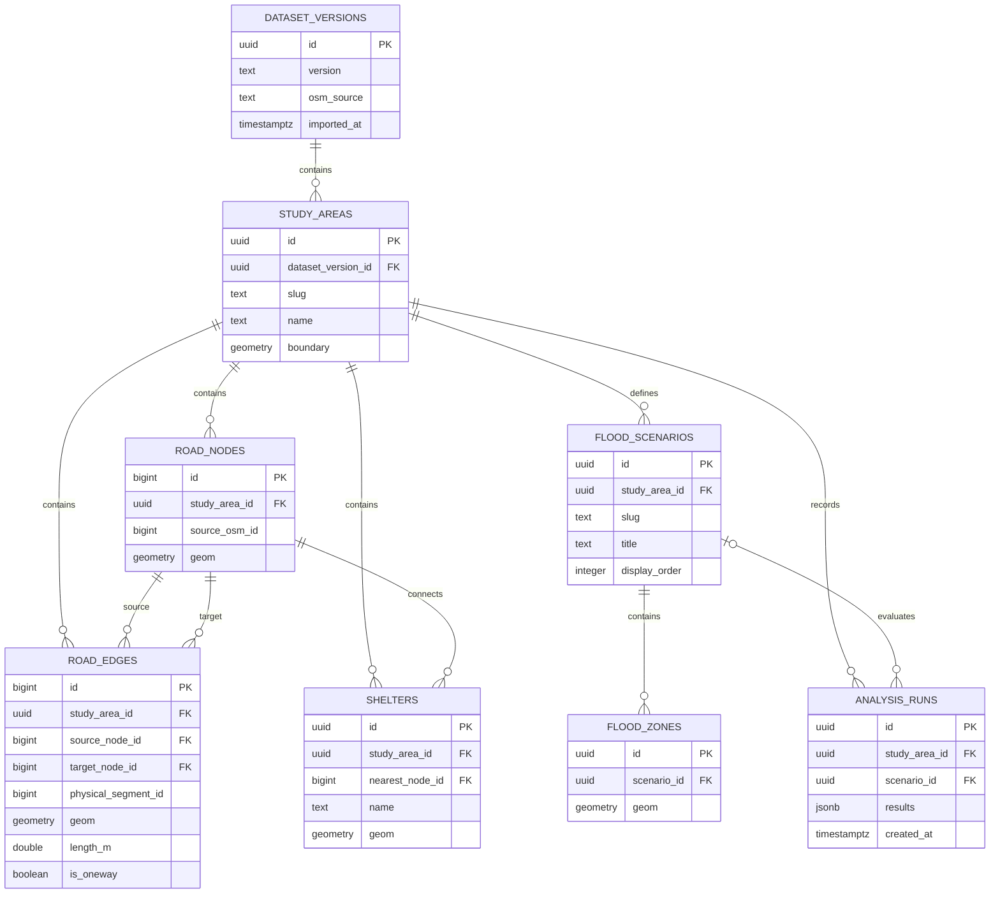

# 06 — DATABASE SCHEMA & POSTGIS IMPLEMENTATION

**Project:** Flood Digital Twin  
**Challenge:** CL-01 — Flood Risk & Evacuation Planner  
**Version:** 1.0  
**Status:** Implementation Specification  
**Database:** PostgreSQL + PostGIS  
**Hosting:** Heroku Essential PostgreSQL  
**ORM:** Drizzle ORM + Parameterized PostGIS SQL  
**Routing:** TypeScript Dijkstra/A* — no pgRouting dependency

---

# 1. Database Objectives

The database must support a real, deterministic geospatial analysis workflow:

1. Load a selected study area.
2. Retrieve a connected OpenStreetMap-derived road network.
3. Store three predefined simulated flood scenarios.
4. Identify physical road segments intersecting simulated flood polygons.
5. Provide graph data to the TypeScript routing engine.
6. Store shelter locations and their associated road-network connections.
7. Calculate route and shelter accessibility from actual network topology.
8. Preserve geographic dataset provenance and version information.

The database must NOT pretend that:

- Simulated flood polygons are verified forecasts.
- Imported shelter records are necessarily operational.
- Straight-line connections are drivable roads.
- A road is safe merely because it falls outside a simulated polygon.
- AI-generated information is authoritative geographic data.

---

# 2. Core Architectural Decisions

| Decision | Implementation |
|---|---|
| Spatial database | PostgreSQL + PostGIS |
| Geographic SRID | EPSG:4326 |
| Coordinates | Longitude, latitude |
| Metric distances | Precomputed `length_m` from validated projected/geodesic calculations |
| Standard data operations | Drizzle ORM |
| Geographic calculations | Parameterized PostGIS SQL |
| Shortest-path computation | TypeScript backend |
| Graph representation | Nodes and directed edges |
| Scenario closure policy | Any geometric intersection marks a physical segment affected |
| Caching | Backend in-memory cache |
| Dataset loading | Explicit import/seed process |
| Runtime database migrations | Separate deployment step |
| Heavy raster processing | Out of MVP scope |

## 2.1 Why Not pgRouting?

The available Heroku database does not permit enabling the required pgRouting extension.

Therefore:

- PostGIS performs spatial queries.
- TypeScript performs graph algorithms.
- Routing must not depend on pgRouting being installed.

## 2.2 Storage Target

Aim to keep project-owned database storage below approximately **350 MB**.

This is a planning target, not a guaranteed Heroku plan limit.

Before importing:

- Check actual database quota.
- Confirm available storage.
- Estimate table and index sizes.
- Use one compact study area.
- Avoid importing irrelevant OSM features.

---

# 3. Entity Relationship Diagram



**Important:** This is a conceptual relationship diagram. The SQL schema below is authoritative.

---

# 4. Database Tables

## 4.1 `dataset_versions`

### Purpose

Record where the geographic data came from and when it was imported.

### Fields

| Column | Type | Notes |
|---|---|---|
| `id` | UUID | Primary key |
| `version` | TEXT | Unique dataset version |
| `osm_source` | TEXT | OSM source/download reference |
| `osm_license` | TEXT | ODbL attribution |
| `retrieved_at` | TIMESTAMPTZ | Source retrieval time |
| `imported_at` | TIMESTAMPTZ | Import time |
| `import_status` | TEXT | pending, ready, failed |
| `metadata` | JSONB | Supplemental import details |

### Rules

- Every imported graph must be traceable to a dataset version.
- Only validated, ready datasets should be exposed to live routing.
- An import must not silently overwrite an active dataset.

---

## 4.2 `study_areas`

### Purpose

Describe the selected geographic analysis area.

### Fields

| Column | Type | Notes |
|---|---|---|
| `id` | UUID | Primary key |
| `dataset_version_id` | UUID | FK |
| `slug` | TEXT | Public identifier |
| `name` | TEXT | Human-readable study-area name |
| `boundary` | MULTIPOLYGON | Geographic extent |
| `map_center` | POINT | Initial map focus |
| `default_zoom` | DOUBLE | Initial viewport |
| `is_active` | BOOLEAN | Active study area |

### Rules

- MVP supports one active study area.
- More study areas can be imported later.
- Geographic coordinates remain EPSG:4326.

---

## 4.3 `road_nodes`

### Purpose

Represent vertices of the imported road graph.

### Fields

| Column | Type | Notes |
|---|---|---|
| `id` | BIGINT | Internal graph vertex |
| `study_area_id` | UUID | FK |
| `source_osm_id` | BIGINT NULL | External provenance |
| `geom` | POINT | Node location |
| `node_type` | TEXT | intersection, endpoint, connector |
| `created_at` | TIMESTAMPTZ | Import time |

### Rules

- Node IDs are stable within a dataset version.
- Every routed edge endpoint must reference a valid node.
- Coincident points are not necessarily connected if roads are grade-separated.
- The importer must handle real topology.

---

## 4.4 `road_edges`

### Purpose

Store traversable directed connections between road nodes.

### Fields

| Column | Type | Notes |
|---|---|---|
| `id` | BIGINT | Directed edge ID |
| `study_area_id` | UUID | FK |
| `source_node_id` | BIGINT | FK |
| `target_node_id` | BIGINT | FK |
| `physical_segment_id` | BIGINT | Shared physical road segment ID |
| `osm_way_id` | BIGINT NULL | OSM provenance |
| `road_name` | TEXT NULL | Optional |
| `highway_type` | TEXT NULL | OSM classification |
| `is_oneway` | BOOLEAN | Source-road property |
| `length_m` | DOUBLE | Positive distance |
| `geom` | LINESTRING | Directed edge geometry |
| `is_routable` | BOOLEAN | Import validation |
| `created_at` | TIMESTAMPTZ | Import time |

### Graph Modeling Policy

Each `road_edges` record represents a directed traversable arc.

For bidirectional physical road segments:

- Import two opposite directed edges.
- Give them the same `physical_segment_id`.
- Reverse the geometry coordinates appropriately.

For one-way roads:

- Import only the permitted direction.
- Preserve the relevant physical segment ID.

A flood closure is determined for the **physical segment** and then applied to every directed arc associated with it.

### Important

`is_oneway` describes the original road property; it does not replace the directed-edge representation.

For road-impact metrics, count distinct `physical_segment_id` values rather than counting both directions as separate roads.

---

## 4.5 `flood_scenarios`

### Purpose

Store predefined, versioned simulated flood conditions.

### Fields

| Column | Type | Notes |
|---|---|---|
| `id` | UUID | Primary key |
| `study_area_id` | UUID | FK |
| `slug` | TEXT | Public identifier |
| `title` | TEXT | Display label |
| `description` | TEXT | Methodology explanation |
| `display_order` | INTEGER | UI order |
| `scenario_type` | TEXT | simulated |
| `is_active` | BOOLEAN | Available in UI |
| `created_at` | TIMESTAMPTZ | Creation time |

### Required Scenarios

MVP must provide three predefined non-baseline simulations.

Baseline is represented by **no flood scenario applied**, not by an automatically invented flood polygon.

---

## 4.6 `flood_zones`

### Purpose

Store one or more polygons for each simulated flood scenario.

### Fields

| Column | Type | Notes |
|---|---|---|
| `id` | UUID | Primary key |
| `scenario_id` | UUID | FK |
| `geom` | MULTIPOLYGON | Simulated affected area |
| `zone_label` | TEXT | Optional |
| `methodology` | TEXT | How geometry was prepared |
| `created_at` | TIMESTAMPTZ | Creation time |

### Rules

- Geometry must be valid.
- Empty geometries are rejected.
- Flood zones must be documented as simulated.
- The system must not infer flood depth from polygons alone.

---

## 4.7 `shelters`

### Purpose

Store locations and network-connection information for candidate shelters.

### Fields

| Column | Type | Notes |
|---|---|---|
| `id` | UUID | Primary key |
| `study_area_id` | UUID | FK |
| `nearest_node_id` | BIGINT NULL | FK |
| `name` | TEXT | Display name |
| `geom` | POINT | Location |
| `capacity` | INTEGER NULL | Unknown if unavailable |
| `data_status` | TEXT | verified, unverified, demonstration |
| `source_name` | TEXT NULL | Provenance |
| `snap_distance_m` | DOUBLE NULL | Distance to graph node |
| `created_at` | TIMESTAMPTZ | Creation time |

### Important Modeling Rule

A shelter's graph-node association is a **modeled routing connection**, not proof that a safe physical access path exists.

The importer must enforce a reasonable maximum snapping distance.

If a shelter cannot be connected validly, preserve it with `nearest_node_id = NULL` and show **Unknown / Not evaluated** in analysis.

Never fabricate shelter capacities.

---

## 4.8 `analysis_runs`

### Purpose

Optionally persist reproducible analysis summaries and demo runs.

### Fields

| Column | Type | Notes |
|---|---|---|
| `id` | UUID | Primary key |
| `study_area_id` | UUID | FK |
| `scenario_id` | UUID NULL | Baseline if null |
| `dataset_version_id` | UUID | FK |
| `analysis_type` | TEXT | route, shelter, scenario |
| `input_parameters` | JSONB | Validated request context |
| `results` | JSONB | Deterministic result |
| `created_at` | TIMESTAMPTZ | Timestamp |

### MVP Priority

P1.

Do not implement this table before core routing works.

Avoid storing large GeoJSON route payloads repeatedly.

---

# 5. Authoritative SQL Migration

## 5.1 Prerequisites

The database must already support:

```sql
CREATE EXTENSION IF NOT EXISTS postgis;
```

On managed Heroku PostgreSQL, confirm the extension is enabled and usable.

Use migrations with appropriate ownership and permissions.

## 5.2 Schema Creation

```sql
BEGIN;

CREATE TABLE dataset_versions (
  id UUID PRIMARY KEY,
  version TEXT NOT NULL UNIQUE,
  osm_source TEXT NOT NULL,
  osm_license TEXT NOT NULL DEFAULT 'ODbL',
  retrieved_at TIMESTAMPTZ,
  imported_at TIMESTAMPTZ NOT NULL DEFAULT NOW(),
  import_status TEXT NOT NULL DEFAULT 'pending'
    CHECK (import_status IN ('pending', 'ready', 'failed')),
  metadata JSONB NOT NULL DEFAULT '{}'::jsonb
);

CREATE TABLE study_areas (
  id UUID PRIMARY KEY,
  dataset_version_id UUID NOT NULL
    REFERENCES dataset_versions(id),
  slug TEXT NOT NULL UNIQUE,
  name TEXT NOT NULL,
  boundary geometry(MultiPolygon, 4326) NOT NULL,
  map_center geometry(Point, 4326) NOT NULL,
  default_zoom DOUBLE PRECISION NOT NULL DEFAULT 11
    CHECK (default_zoom BETWEEN 1 AND 22),
  is_active BOOLEAN NOT NULL DEFAULT FALSE
);

CREATE TABLE road_nodes (
  id BIGINT PRIMARY KEY,
  study_area_id UUID NOT NULL
    REFERENCES study_areas(id) ON DELETE CASCADE,
  source_osm_id BIGINT,
  geom geometry(Point, 4326) NOT NULL,
  node_type TEXT NOT NULL DEFAULT 'connector'
    CHECK (node_type IN ('intersection', 'endpoint', 'connector')),
  created_at TIMESTAMPTZ NOT NULL DEFAULT NOW(),
  UNIQUE (id, study_area_id)
);

CREATE TABLE road_edges (
  id BIGINT PRIMARY KEY,
  study_area_id UUID NOT NULL
    REFERENCES study_areas(id) ON DELETE CASCADE,
  source_node_id BIGINT NOT NULL,
  target_node_id BIGINT NOT NULL,
  physical_segment_id BIGINT NOT NULL,
  osm_way_id BIGINT,
  road_name TEXT,
  highway_type TEXT,
  is_oneway BOOLEAN NOT NULL DEFAULT FALSE,
  length_m DOUBLE PRECISION NOT NULL
    CHECK (length_m > 0 AND isfinite(length_m)),
  geom geometry(LineString, 4326) NOT NULL,
  is_routable BOOLEAN NOT NULL DEFAULT TRUE,
  created_at TIMESTAMPTZ NOT NULL DEFAULT NOW(),
  CHECK (source_node_id <> target_node_id),
  FOREIGN KEY (source_node_id, study_area_id)
    REFERENCES road_nodes(id, study_area_id),
  FOREIGN KEY (target_node_id, study_area_id)
    REFERENCES road_nodes(id, study_area_id),
  UNIQUE (id, study_area_id)
);

CREATE TABLE flood_scenarios (
  id UUID PRIMARY KEY,
  study_area_id UUID NOT NULL
    REFERENCES study_areas(id) ON DELETE CASCADE,
  slug TEXT NOT NULL,
  title TEXT NOT NULL,
  description TEXT,
  display_order INTEGER NOT NULL DEFAULT 0,
  scenario_type TEXT NOT NULL DEFAULT 'simulated'
    CHECK (scenario_type = 'simulated'),
  is_active BOOLEAN NOT NULL DEFAULT TRUE,
  created_at TIMESTAMPTZ NOT NULL DEFAULT NOW(),
  UNIQUE (study_area_id, slug)
);

CREATE TABLE flood_zones (
  id UUID PRIMARY KEY,
  scenario_id UUID NOT NULL
    REFERENCES flood_scenarios(id) ON DELETE CASCADE,
  geom geometry(MultiPolygon, 4326) NOT NULL,
  zone_label TEXT,
  methodology TEXT,
  created_at TIMESTAMPTZ NOT NULL DEFAULT NOW()
);

CREATE TABLE shelters (
  id UUID PRIMARY KEY,
  study_area_id UUID NOT NULL
    REFERENCES study_areas(id) ON DELETE CASCADE,
  nearest_node_id BIGINT,
  name TEXT NOT NULL,
  geom geometry(Point, 4326) NOT NULL,
  capacity INTEGER CHECK (capacity >= 0),
  data_status TEXT NOT NULL DEFAULT 'unverified'
    CHECK (data_status IN ('verified', 'unverified', 'demonstration')),
  source_name TEXT,
  snap_distance_m DOUBLE PRECISION
    CHECK (
      snap_distance_m IS NULL OR
      (snap_distance_m >= 0 AND isfinite(snap_distance_m))
    ),
  created_at TIMESTAMPTZ NOT NULL DEFAULT NOW(),
  FOREIGN KEY (nearest_node_id, study_area_id)
    REFERENCES road_nodes(id, study_area_id)
);

CREATE TABLE analysis_runs (
  id UUID PRIMARY KEY,
  study_area_id UUID NOT NULL
    REFERENCES study_areas(id),
  scenario_id UUID REFERENCES flood_scenarios(id),
  dataset_version_id UUID NOT NULL
    REFERENCES dataset_versions(id),
  analysis_type TEXT NOT NULL
    CHECK (analysis_type IN ('route', 'shelter', 'scenario')),
  input_parameters JSONB NOT NULL DEFAULT '{}'::jsonb,
  results JSONB NOT NULL DEFAULT '{}'::jsonb,
  created_at TIMESTAMPTZ NOT NULL DEFAULT NOW()
);

COMMIT;
```

## 5.3 Geometry Validity Constraints

Add these after validating existing imported data:

```sql
ALTER TABLE study_areas
ADD CONSTRAINT study_areas_valid_boundary
CHECK (
  ST_IsValid(boundary)
  AND NOT ST_IsEmpty(boundary)
);

ALTER TABLE flood_zones
ADD CONSTRAINT flood_zones_valid_geom
CHECK (
  ST_IsValid(geom)
  AND NOT ST_IsEmpty(geom)
);

ALTER TABLE road_edges
ADD CONSTRAINT road_edges_valid_geom
CHECK (
  ST_IsValid(geom)
  AND NOT ST_IsEmpty(geom)
);
```

Additional import validation must confirm that a directed road edge's first coordinate matches its source node and its last coordinate matches its target node within a defined tolerance.

---

# 6. Index Strategy

## 6.1 Spatial Indexes

```sql
CREATE INDEX idx_study_areas_boundary_gist
ON study_areas USING GIST (boundary);

CREATE INDEX idx_road_nodes_geom_gist
ON road_nodes USING GIST (geom);

CREATE INDEX idx_road_edges_geom_gist
ON road_edges USING GIST (geom);

CREATE INDEX idx_flood_zones_geom_gist
ON flood_zones USING GIST (geom);

CREATE INDEX idx_shelters_geom_gist
ON shelters USING GIST (geom);
```

## 6.2 Relational Indexes

```sql
CREATE INDEX idx_road_nodes_area
ON road_nodes (study_area_id);

CREATE INDEX idx_road_edges_area
ON road_edges (study_area_id);

CREATE INDEX idx_road_edges_source
ON road_edges (source_node_id);

CREATE INDEX idx_road_edges_target
ON road_edges (target_node_id);

CREATE INDEX idx_road_edges_physical_segment
ON road_edges (study_area_id, physical_segment_id);

CREATE INDEX idx_flood_scenarios_area
ON flood_scenarios (study_area_id);

CREATE INDEX idx_flood_zones_scenario
ON flood_zones (scenario_id);

CREATE INDEX idx_shelters_area
ON shelters (study_area_id);

CREATE INDEX idx_analysis_runs_created
ON analysis_runs (created_at DESC);
```

## 6.3 Index Usage Rules

- GiST indexes support spatial intersection queries.
- B-tree indexes support filtering and joins.
- Do not create redundant indexes without measuring query plans.
- Use `EXPLAIN ANALYZE` during performance review.

---

# 7. Core Spatial Queries

## 7.1 Find Affected Physical Road Segments

A simulated flood affects a physical segment when any associated directed edge geometry intersects a flood polygon.

```sql
SELECT DISTINCT
  e.physical_segment_id
FROM road_edges AS e
JOIN flood_scenarios AS s
  ON s.study_area_id = e.study_area_id
JOIN flood_zones AS z
  ON z.scenario_id = s.id
WHERE
  s.id = $1::uuid
  AND e.is_routable = TRUE
  AND e.geom && z.geom
  AND ST_Intersects(e.geom, z.geom);
```

**Output:** Unique physical segment IDs affected by the selected scenario.

### Policy Notes

`ST_Intersects` includes boundary contact.

This is intentionally conservative for the MVP.

However, the result means **affected under the model's intersection rule**, not definitively unsafe in real life.

## 7.2 Find Directed Road Edges to Block

```sql
WITH affected_segments AS (
  SELECT DISTINCT e.physical_segment_id
  FROM road_edges AS e
  JOIN flood_scenarios AS s
    ON s.study_area_id = e.study_area_id
  JOIN flood_zones AS z
    ON z.scenario_id = s.id
  WHERE s.id = $1::uuid
    AND e.is_routable = TRUE
    AND e.geom && z.geom
    AND ST_Intersects(e.geom, z.geom)
)
SELECT e.id
FROM road_edges AS e
JOIN flood_scenarios AS s
  ON s.study_area_id = e.study_area_id
JOIN affected_segments AS a
  ON a.physical_segment_id = e.physical_segment_id
WHERE s.id = $1::uuid
  AND e.is_routable = TRUE;
```

Every directed arc associated with an affected physical segment is blocked.

## 7.3 Affected Road Segment Count

```sql
SELECT COUNT(DISTINCT e.physical_segment_id) AS affected_segments
FROM road_edges AS e
JOIN flood_scenarios AS s
  ON s.study_area_id = e.study_area_id
JOIN flood_zones AS z
  ON z.scenario_id = s.id
WHERE s.id = $1::uuid
  AND e.is_routable = TRUE
  AND ST_Intersects(e.geom, z.geom);
```

## 7.4 Retrieve the Routable Graph

```sql
SELECT
  id,
  source_node_id,
  target_node_id,
  physical_segment_id,
  length_m,
  ST_AsGeoJSON(geom)::json AS geometry
FROM road_edges
WHERE study_area_id = $1::uuid
  AND is_routable = TRUE
ORDER BY id;
```

For backend graph construction, load graph nodes separately and build adjacency lists in memory.

Avoid fetching large edge geometry repeatedly for every route request.

### Performance Improvement

Maintain in-memory mappings:

```text id="ms7uhv"
edgeId -> graph edge
nodeId -> adjacency list
physicalSegmentId -> directed edge IDs
```

When a scenario activates, remove or skip affected arcs during graph traversal.

---

# 8. Shelter Spatial Queries

## 8.1 Find Candidate Nearest Network Node

```sql
SELECT
  n.id,
  ST_Distance(
    n.geom::geography,
    $1::geometry(Point, 4326)::geography
  ) AS distance_m
FROM road_nodes AS n
WHERE n.study_area_id = $2::uuid
ORDER BY n.geom <-> $1::geometry(Point, 4326)
LIMIT 10;
```

### Important

The geometry KNN operator ranks nearby candidates using the geometry index.

The application should then:

1. Evaluate exact geography distance among returned candidates.
2. Check graph connectivity.
3. Check the maximum allowed snap distance.
4. Select a valid candidate.
5. Otherwise mark the shelter connection unknown.

The nearest geometric node is not automatically an accessible entrance.

## 8.2 Shelter Reachability Computation

Reachability is calculated in TypeScript:

```text id="gjrt8x"
Selected origin
    |
    v
Validated graph node
    |
    v
Scenario blocked-edge set
    |
    v
Dijkstra traversal
    |
    v
Computed graph distances
    |
    +--> Shelter 1: reachable
    |
    +--> Shelter 2: unreachable
    |
    +--> Shelter 3: unknown connection
```

Do not calculate route reachability using straight-line geographic distance.

---

# 9. Route Data Contract

The database stores the graph.

The backend returns routes.

## 9.1 Internal Route Result

```ts
type RouteResult =
  | {
      status: "reachable";
      sourceNodeId: string;
      targetNodeId: string;
      edgeIds: string[];
      distanceMeters: number;
      geometry: GeoJSON.LineString;
    }
  | {
      status: "unreachable";
      sourceNodeId: string;
      targetNodeId: string;
      reason: "disconnected" | "scenario_blocked";
    };
```

Use strings when serializing BIGINT identifiers to JSON.

## 9.2 Backend Verification

Before returning a reachable route:

- Every edge must exist.
- Consecutive edges must connect.
- Every edge must follow permitted direction.
- No edge may be in the blocked set.
- Distance must equal the accumulated edge weights within tolerance.
- Geometry must follow the selected graph path.

---

# 10. Dataset Import Pipeline

## 10.1 Import Sources

Roads:

OpenStreetMap-derived geographic data.

Flood polygons:

Documented, predefined simulated GeoJSON files.

Shelters:

Verified public data where available, or explicitly identified demonstration records.

## 10.2 Import Workflow

```text id="qn3h89"
Acquire bounded source data
    |
    v
Validate coordinates and geometry
    |
    v
Extract eligible road classes
    |
    v
Split at valid road junctions
    |
    v
Respect one-way and grade separation
    |
    v
Build directed graph
    |
    v
Calculate metric edge lengths
    |
    v
Import graph nodes and edges
    |
    v
Import simulated flood polygons
    |
    v
Validate shelter node snapping
    |
    v
Run graph and spatial QA
    |
    v
Mark dataset version READY
```

## 10.3 Road Import Rules

- Use a clearly documented included road-class policy.
- Respect `oneway` metadata.
- Handle roundabouts correctly.
- Do not connect bridges to roads beneath them unless actual junctions exist.
- Preserve graph component information during validation.
- Clip carefully: clipping at the study-area boundary may create artificial dead ends.
- Validate edge geometry order.

## 10.4 Geometry Import

Use the same coordinate convention across the application:

**GeoJSON coordinates = `[longitude, latitude]`.**

Reject:

- Malformed polygons.
- Invalid coordinates.
- Empty geometry.
- Mixed or undocumented SRIDs.

---

# 11. Baseline and Scenario Semantics

## 11.1 Baseline

Baseline means:

- No simulated flood closures applied.
- Routable graph uses imported edge eligibility.
- Actual road accessibility is not independently verified.

## 11.2 Active Scenario

Active scenario means:

- Flood polygon is loaded.
- Physical road segments are evaluated for intersection.
- Associated directed edges are blocked.
- Routes and shelters are recalculated using the modified graph.

## 11.3 Reproducibility

Every analysis should be associated with:

```text id="lggme6"
datasetVersion
studyAreaId
scenarioId or baseline
closurePolicyVersion
originNodeId
destinationNodeId
algorithmVersion
```

Changes to the road dataset or closure policy must invalidate related cached results.

---

# 12. Database Integrity Requirements

## 12.1 Referential Integrity

All road edges must reference valid graph nodes in the same study area.

All flood zones must reference an existing scenario.

All scenarios must reference an existing study area.

All snapped shelters must reference a valid graph node in the same study area.

## 12.2 Geometric Integrity

Validate:

- Nonempty geometry.
- Correct SRID.
- LineString has at least two distinct coordinates.
- Polygon validity.
- Node/edge coordinate agreement.
- Plausible metric edge lengths.
- No invalid zero-length graph arcs.

## 12.3 Dataset Version Integrity

A study area must be associated with its imported dataset version.

Every active road graph must have passed validation.

Avoid modifying imported graph records manually during a live demo.

## 12.4 Cross-Study-Area Checks

The database enforces same-study-area membership for graph edge endpoints and shelter snapped nodes.

For any scenario/zone/report relationship not enforced by composite keys, the service/import validation must confirm study-area compatibility.

---

# 13. Database Migration Strategy

## 13.1 Migration Ownership

Use one defined migration system.

Recommended:

- Drizzle migrations for ordinary schema evolution.
- Explicit SQL migrations for PostGIS-specific objects and indexes.

Do not execute unmanaged schema changes on application startup.

## 13.2 Commands

Suggested workflow:

```bash
pnpm db:generate
pnpm db:migrate
pnpm db:seed
pnpm db:validate
```

These commands are expected project scripts, not guaranteed built-in commands.

Agents must implement them.

## 13.3 Safe Migration Rules

- Keep schema changes version controlled.
- Review destructive migrations.
- Preserve imported data until replacement is validated.
- Avoid resetting the production DB during demos.
- Back up before destructive changes.

---

# 14. Seed Data Plan

## 14.1 Required MVP Data

- One study area.
- One ready dataset version.
- Connected road graph.
- Three predefined simulated flood scenarios.
- Flood polygons for each scenario.
- A small, documented set of shelter candidates.

## 14.2 Data Quality Is More Important Than Volume

Prefer:

- A compact connected network.
- Real OSM road geometry.
- Clear scenario polygons.
- Repeatable routing cases.
- A demonstrable blocked-road reroute.

Avoid:

- Importing an entire province.
- Huge raster datasets.
- Arbitrary shelters with no graph connection.
- Massive road graphs without validation.

## 14.3 Essential Demo Fixture

Prepare one verified data fixture with:

1. A baseline route.
2. A scenario that intersects at least one baseline road segment.
3. A valid alternate route if network topology permits.
4. At least one shelter with a valid reachable path.
5. An unreachable test case if the dataset genuinely supports it.

This must be verified against actual graph calculations.

---

# 15. Database Performance & Storage

## 15.1 Primary Optimization

Limit geographic study-area size.

## 15.2 Storage Guidelines

- Exclude unnecessary OSM tags.
- Avoid storing duplicate large geometry representations.
- Use BIGINT graph IDs.
- Keep JSONB metadata compact.
- Avoid storing every route calculation.
- Keep indexes focused.
- Avoid raster storage in PostgreSQL for MVP.

## 15.3 Monitor Storage

Suggested checks:

```sql
SELECT
  pg_size_pretty(pg_database_size(current_database()))
  AS database_size;
```

```sql
SELECT
  relname AS table_name,
  pg_size_pretty(pg_total_relation_size(relid)) AS total_size
FROM pg_catalog.pg_statio_user_tables
ORDER BY pg_total_relation_size(relid) DESC;
```

## 15.4 Query Performance

Run:

```sql
EXPLAIN ANALYZE
SELECT ...
```

Replace the placeholder with the actual query under review.

Evaluate spatial intersections with realistic data volume.

---

# 16. Security Requirements

## 16.1 Connection Handling

- Store `DATABASE_URL` only in backend/Kubernetes secrets.
- Require TLS according to the managed provider's connection configuration.
- Do not embed database credentials in frontend code.
- Do not log connection strings.
- Use a bounded connection pool.

## 16.2 Query Safety

- Parameterize raw SQL.
- Validate UUIDs and coordinates.
- Validate study-area identifiers.
- Apply reasonable query limits.
- Restrict direct database access.
- Avoid arbitrary user-submitted SQL.

## 16.3 Public API Separation

Frontend communicates with the Fastify backend.

Frontend must never connect directly to PostgreSQL.

---

# 17. Testing Requirements

## DB-01 — Spatial Extension

Confirm:

```sql
SELECT PostGIS_Version();
```

Expected: A valid installed PostGIS version.

## DB-02 — Graph References

No road edge may reference missing nodes.

## DB-03 — Positive Lengths

All routable edges have finite positive lengths.

## DB-04 — Directed Topology

One-way rules are respected.

## DB-05 — Flood Intersection

A known intersecting segment is returned as affected.

## DB-06 — Nonintersection

An unaffected segment is not falsely returned.

## DB-07 — Bidirectional Closure

When a physical road segment is affected, both associated direction arcs are blocked.

## DB-08 — Shelter Snapping

Shelters beyond the accepted snapping threshold are not assigned an arbitrary node.

## DB-09 — Baseline Routing

A known connected pair has a valid baseline path.

## DB-10 — Scenario Routing

A blocked baseline edge produces an updated valid path or unreachable status.

## DB-11 — Dataset Version

Every active study area references a ready import.

## DB-12 — Storage Validation

Total database storage remains within the confirmed managed-plan quota.

## DB-13 — Geometry Validation

Invalid or empty flood polygons are rejected.

## DB-14 — No Fabricated Results

Route output derives from imported road graph geometry.

---

# 18. Agent Implementation Checklist

- [ ] Confirm PostGIS extension works.
- [ ] Establish database connection from backend.
- [ ] Implement schema migrations.
- [ ] Create all P0 tables.
- [ ] Create required spatial indexes.
- [ ] Create required relational indexes.
- [ ] Build bounded OSM importer.
- [ ] Build valid directed road topology.
- [ ] Validate road edge coordinates and lengths.
- [ ] Import one compact study area.
- [ ] Import three simulated flood scenarios.
- [ ] Import and validate shelter candidates.
- [ ] Implement spatial intersection query.
- [ ] Convert affected physical segments into blocked arcs.
- [ ] Expose road graph to TypeScript routing service.
- [ ] Validate baseline shortest path.
- [ ] Validate scenario-aware shortest path.
- [ ] Validate shelter reachability.
- [ ] Check data provenance.
- [ ] Check managed PostgreSQL storage.
- [ ] Confirm no pgRouting dependency.

---

# 19. Technical Risks & Mitigations

| Risk | Mitigation |
|---|---|
| pgRouting unavailable | TypeScript graph routing |
| Poor OSM topology | Import-time validation and graph QA |
| Database storage exceeded | Smaller bounded study area |
| Invalid flood polygons | Geometry validation |
| Over-blocking at polygon boundaries | Document conservative intersection policy |
| Incorrect road-direction logic | Directed arcs and directional tests |
| Disconnected shelter connections | Snapping threshold and unknown status |
| Slow intersection queries | GiST spatial indexes |
| Stale scenario results | Version-aware caching |
| Incorrect map geometry | Validate SRID and GeoJSON coordinate order |
| Managed DB network failures | Bounded pool, error handling and retries where appropriate |

---

# 20. Definition of Done

The database implementation is complete for the hackathon MVP when:

1. PostgreSQL and PostGIS are operational.
2. One study area is imported.
3. A connected OSM-derived road graph exists.
4. Directional road topology is valid.
5. Three simulated scenarios exist.
6. Flood polygons are valid.
7. Affected physical road segments can be calculated.
8. All affected directed arcs are correctly blocked.
9. Shelter candidates are linked to valid graph nodes or explicitly marked unknown.
10. The TypeScript routing engine receives the correct graph.
11. Baseline routes are reproducible.
12. Scenario routes are reproducible.
13. The geographic output follows actual road geometry.
14. Database usage stays inside the confirmed quota.
15. All data provenance is documented.
16. Migration and seed operations are repeatable.
17. Relevant tests pass.

---

# 21. Important Implementation Notes

## 21.1 Baseline Is Not a Verified Safety Condition

No scenario closure does not mean actual roads are safe.

## 21.2 PostGIS Is Not the Routing Engine

PostGIS computes geometric intersections and spatial queries.

TypeScript computes network routes.

## 21.3 Directed Edge IDs Must Remain Stable

Caching, route reconstruction and blocked-edge mapping depend on stable IDs within a dataset version.

## 21.4 Physical Road Counts Differ from Directed Arc Counts

Use physical segment IDs for user-facing affected-road metrics.

Use directed arc IDs inside graph traversal.

## 21.5 Keep the MVP Small and Correct

A compact, validated road network that demonstrates rerouting is more valuable than a huge, unreliable network.

---

**Document Status:** `06-DATABASE-SCHEMA.md` — Ready for Implementation

**Next Document:** `07-GEOSPATIAL-DATA-PLAN.md`
